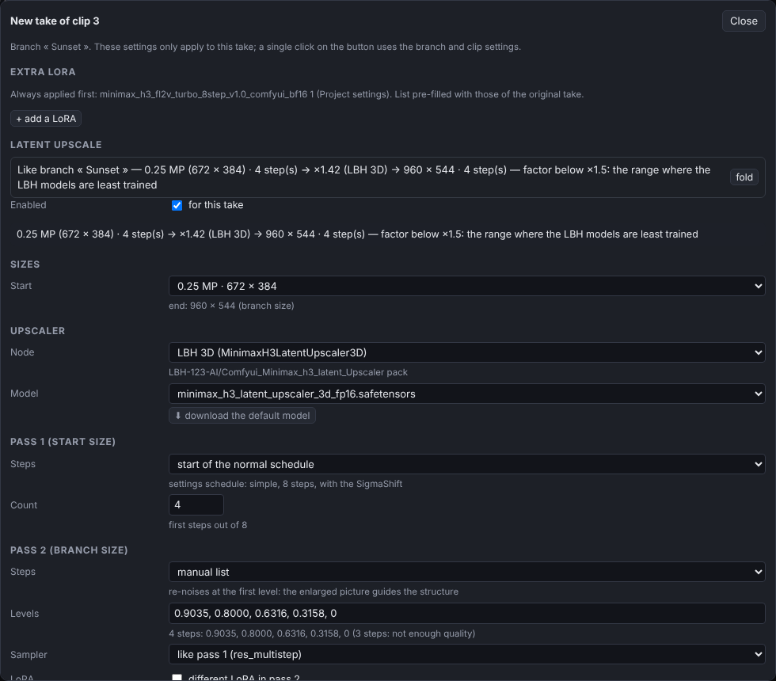

<p align="center">
  
</p>

<h1 align="center">Encore</h1>

<p align="center">
  <b>Un studio local pour clips musicaux et courts métrages MiniMax H3, piloté via ComfyUI.</b><br>
  Plans, branches, prises, file de générations et assemblage, dans votre navigateur.
</p>

<p align="center">
  <a href="LICENSE"></a>
  
  
  <a href="README.md"></a>
</p>

> **Avertissement : ce projet est entièrement « vibe-codé ».** Tout son code, sa documentation et
> ses tests ont été écrits par un assistant IA (Claude, d'Anthropic), à la demande de l'auteur.
> L'auteur a défini les fonctionnalités et testé le résultat à l'usage, mais n'a ni écrit ni relu
> le code. Lisez-le, testez-le sur votre propre installation et utilisez-le à vos risques ; les
> signalements et corrections sont les bienvenus.


## Ce que fait Encore

[MiniMax H3](https://huggingface.co/Comfy-Org/MiniMax-H3) produit des clips d'une dizaine de
secondes, image et son, à partir d'images de référence. Un clip musical ou un court métrage est
une suite de tels clips qui s'enchaînent. Le plugin ComfyUI
[ComfyUI-H3-ClipPlan](https://github.com/timpatim/ComfyUI-H3-ClipPlan) décrit cette suite dans un
**plan** (un fichier JSON : un prompt par clip, quel clip continue lequel, les références, la
chanson). Encore est l'application autour :

- **Éditeur de plan** : les clips sur une frise au-dessus de la chanson, prompts édités par
  section, références et sujets en pastilles, contrôles du plan et de chaque clip.
- **Prises en arbre** : chaque génération est une prise ; une suite est construite sur la prise
  exacte qu'elle continue. Essayez plusieurs prises, gardez la meilleure chaîne, revenez à une
  plus ancienne.
- **Branches** : le même plan avec d'autres images, une autre taille, d'autres LoRA ou réglages
  d'upscale, côte à côte, sans mélanger leurs prises.
- **File de générations** : un travail à la fois dans ComfyUI, survit à un redémarrage de ComfyUI
  ou d'Encore, réordonnable, en pause et reprise ; **▶▶ compléter** remplit toute une branche.
- **Upscale latent** (optionnel) : générer petit, puis agrandir dans une seconde passe.
- **Assemblage** : un clic met bout à bout les prises choisies sur la chanson en une vidéo.
- **Points de sauvegarde**, **fenêtres de plan** qui disent exactement comment une prise a été
  faite, un écran d'installation qui installe les packs de nœuds et télécharge les modèles,
  anglais et français, thèmes sombre et clair.

ComfyUI ne sert que de moteur : Encore lui parle à son adresse et ne modifie jamais ses workflows.

## Captures d'écran

**Éditeur de plan : les clips sur la chanson, prompts par section, références et contrôles**


**Fenêtre de plan ≡ d'une prise : le plan avec lequel elle a été faite et tout ce qui a servi à la générer**


**« Prise réglée » (▾) : d'autres LoRA, réglages d'upscale ou graine pour une seule prise**



**File des générations : réordonner, suspendre, mettre en pause, reprendre**


*(Captures faites avec l'exemple du robot du plugin, interface en anglais ; les prises y sont des
animations de remplacement, pas de vrais rendus H3.)*

## Prérequis

- **Windows** ou **Linux** (Mac non pris en charge pour l'instant), **Python 3.10** ou plus récent.
- Un **[ComfyUI](https://github.com/comfyanonymous/ComfyUI)** qui fonctionne, avec la prise en
  charge de MiniMax H3, sur ce PC ou joignable sur le réseau, et **git** (pour les packs de nœuds).
- Les packs de nœuds ci-dessous ; l'écran d'installation d'Encore peut les installer pour vous :
  [ComfyUI-H3-ClipPlan](https://github.com/timpatim/ComfyUI-H3-ClipPlan) **3.6 ou plus récent**,
  ComfyUI-H3-Motion-Context-MultiRef, ComfyUI-VideoHelperSuite ; optionnels : ComfyUI-KJNodes
  (aperçu animé), les nœuds d'upscale latent LBH (upscale).
- Les modèles H3 (modèle de diffusion, encodeur de texte, VAE, LoRA turbo) : l'écran
  d'installation télécharge ceux par défaut.

Encore lui-même n'utilise que la bibliothèque standard de Python : rien à installer avec `pip`.

## Démarrage rapide

1. Récupérer Encore : `git clone https://github.com/timpatim/Encore.git`, ou **Code > Download
   ZIP** sur GitHub puis décompresser (où vous voulez, pas dans ComfyUI).
2. L'installer et le lancer (détails dans [Installation d'Encore](#installation-dencore)) : sous
   Windows, double-cliquer `install.bat` puis `Encore.bat` ; sous Linux, `./install.sh` puis
   `./encore.sh`. Encore ouvre `http://127.0.0.1:8190` dans le navigateur.
3. **Écran de bienvenue** : donner l'adresse et le dossier de ComfyUI, installer les packs de nœuds
   manquants, redémarrer ComfyUI, télécharger les modèles par défaut.
4. **☰ Projets > Nouveau projet** : un nom, mode *libre* (H3 fait l'image et le son) ou *clip
   musical* (une chanson est posée sous les clips).
5. **Importer un plan…** : un plan écrit à la main, par un LLM (le plugin donne le
   [prompt système](https://github.com/timpatim/ComfyUI-H3-ClipPlan/blob/main/docs/LLM_SYSTEM_PROMPT.md)
   pour ça) ou l'un des `examples/` du plugin. Ou l'écrire dans l'onglet **Plan**.
6. **Ressources…** : importer les images (et la chanson ou les voix) ; puis, dans l'onglet
   **Prises**, le bouton **références…** de la branche donne une image à chaque référence du plan.
7. Onglet **Prises** : cliquer la case du clip 1 pour générer une prise, la case à sa droite pour
   le clip suivant, ou **▶▶ compléter** pour mettre toute la branche en file. Cliquer une prise pour
   la choisir.
8. Survoler la dernière prise : **▶ assembler 1–k** fait la vidéo ; elle apparaît dans le volet
   **▶ Vidéos**.

La suite de cette page est le guide complet.

# Guide d'utilisation

*Encore s'appelait « H3 Studio » jusqu'à sa version 0.16.* L'adresse de ComfyUI est
`http://127.0.0.1:8188` par défaut.

Messages, confirmations et saisies s'ouvrent dans une fenêtre d'Encore, au centre de l'écran
(Entrée valide, Échap annule ; pour une suppression ou une restauration, « Non » a le focus).
Seul l'avertissement de fermeture de l'onglet avec un plan non enregistré reste celui du navigateur.

## Langue

Encore est en anglais par défaut. Page d'accueil > **Réglages par défaut…** > **Langue** : la page
se recharge dans la langue choisie, messages du serveur, fiches `.infos.md` et libellés de la file
compris (ce qui a déjà été écrit, comme un nom de point de sauvegarde, reste tel quel).

Les textes sont dans `encore/locales/<code>.json` (`en.json`, `fr.json`) : `{"identifiant": "texte"}`,
avec des valeurs `{nom}` remplacées à l'affichage. Pour ajouter une langue, copier `en.json` en
`de.json` par exemple, traduire les textes et la clé `_name` (nom affiché dans la liste) : elle
apparaît au prochain lancement. Un texte absent d'un fichier s'affiche en anglais. Les termes de H3
(`subject_definitions`, `fully_preserved`…) et le contenu des prompts ne se traduisent pas.

## Thème clair ou sombre

Sombre par défaut. Le bouton **☀ / ☾** de la barre du haut bascule tout de suite ; le choix est aussi
dans **Réglages par défaut… > Thème**, et il est gardé dans `config.json`. Les pages d'infos des
vidéos le suivent. La feuille de style claire est déduite de la sombre à la construction de la page
(`encore/theme.py`).

## Installation d'Encore

Encore n'utilise que la bibliothèque standard de Python : aucun paquet à télécharger.

**Avec venv** (Python 3.10 ou plus récent installé sur le PC) :

1. Mettre le dossier `Encore` où vous voulez (pas dans ComfyUI) : `git clone https://github.com/timpatim/Encore.git`,
   ou télécharger le ZIP sur GitHub et le décompresser.
2. Double-cliquer `install.bat` : crée l'environnement `.venv` dans ce dossier.
3. Double-cliquer `Encore.bat` : lance Encore et ouvre `http://127.0.0.1:8190`.

**Avec conda** :

```text
conda env create -f environment.yml
conda activate encore
Encore.bat
```

**Sous Linux** (Python 3.10 ou plus récent, avec le module venv : `sudo apt install python3-venv`
sur Debian/Ubuntu) :

```bash
./install.sh     # crée .venv dans le dossier
./encore.sh      # lance Encore (ou, avec conda : conda activate encore puis ./encore.sh)
```

Le Mac n'est pas pris en charge pour l'instant (on peut essayer `python3 -m encore` depuis le
dossier, sans garantie).

Options de lancement : `Encore.bat --port 8191` (ou `./encore.sh --port 8191`), `--no-browser`.
La fenêtre de console doit rester ouverte pendant l'utilisation ; Ctrl+C l'arrête.

**Vous aviez H3 Studio ?** Décompressez `Encore` à côté du dossier `H3Studio` (dans le même dossier
parent) : au premier lancement, Encore reprend `config.json`, `defaults.json` et la file
(`queue.json`). Les projets ne bougent pas. (Dans ComfyUI, la copie de travail garde son nom
`h3studio_…`.)

## Premier lancement : l'écran « Bienvenue dans Encore »

Encore ne va pas plus loin tant que ComfyUI n'a pas tout ce qu'il faut. L'écran se rouvre plus
tard par le bouton **Installation…** de la barre du haut (sans bloquer).

1. **ComfyUI** : son adresse, et son **dossier d'installation** (celui qui contient `custom_nodes`
   et `models` ; pour la version portable, le dossier `ComfyUI_windows_portable` suffit).
   Encore trouve le **Python de ComfyUI** : `python_embeded` (version portable), `.venv` ou `venv`
   (installation manuelle, application Desktop). Sinon, indiquez le chemin de son `python.exe`
   (conda par exemple) ; « Vérifier » le lance et contrôle que torch est là. Il faut aussi **git**
   (Git pour Windows, git-scm.com).
2. **Custom nodes** : la liste des paquets qu'Encore utilise, avec leur état (chargé, installé
   mais ComfyUI pas encore redémarré, absent, version trop ancienne). Les obligatoires
   (ComfyUI-H3-ClipPlan, ComfyUI-H3-Motion-Context-MultiRef, ComfyUI-VideoHelperSuite) sont
   cochés d'office ; les facultatifs (ComfyUI-KJNodes pour l'aperçu animé, nœuds LBH pour
   l'upscale) se cochent au choix ; un paquet déjà présent dans ComfyUI est coché d'office, sans
   pouvoir être décoché. Chaque nom est un lien vers le dépôt du paquet : **vous pouvez aussi
   installer les paquets vous-même** (ComfyUI-Manager, git clone…), Encore les détecte au
   redémarrage de ComfyUI. **Installer** fait un `git clone` dans `custom_nodes` puis
   installe les dépendances (`requirements.txt`) avec le Python de ComfyUI (`-s` pour la version
   portable), sans passer par ComfyUI-Manager. Le journal s'affiche dessous. Un paquet déjà
   présent est reconnu à son nom de dossier ou à l'adresse de son dépôt git.
3. **Redémarrez ComfyUI** : Encore ne le redémarre pas lui-même. Il détecte sa coupure puis son
   retour, relit la liste des nœuds, et le bouton **Continuer** s'active quand tous les paquets
   obligatoires sont chargés.
4. **Modèles par défaut** (facultatif ici) : voir plus bas.

La liste des paquets est dans `encore/data/node_packs.json` (nom, dépôt git, dossier, nœuds
attendus, obligatoire ou non) : on peut en ajouter sans toucher au code.

## Modèles par défaut : téléchargement

Dans l'écran d'installation, et dans les réglages (bouton **⬇ télécharger le modèle par
défaut** sous une liste de modèles quand le fichier par défaut n'est pas dans ComfyUI) :

- modèle de diffusion ref2va pruned int8, encodeur de texte Qwen3-VL 32B int8, VAE vidéo et
  audio, LoRA turbo 8 étapes (dépôt Hugging Face `Comfy-Org/MiniMax-H3`), et le modèle d'upscale
  LBH 3D (`LBH-123-AI/Minimax_h3_latent_Upscaler`) ;
- chaque fichier va dans son sous-dossier de `ComfyUI/models` ;
- **avant de commencer**, Encore lit la taille réelle du fichier sur Hugging Face et la compare
  à l'espace libre du disque, avec 2 Go de marge et en comptant les téléchargements en cours ;
  s'il manque de la place, il refuse en donnant les chiffres ;
- progression, vitesse, annulation ; un téléchargement interrompu reprend où il s'était
  arrêté (fichier `.part`) ;
- un dépôt protégé demande un jeton Hugging Face (`hf_token` dans `config.json`).

La liste est dans `encore/data/models.json`.

## Connexion à ComfyUI

Pastille permanente dans la barre du haut : verte « ComfyUI connecté », orange « reconnexion… »,
rouge « ComfyUI injoignable ». Un clic : adresse, version, depuis quand, « Réessayer ». Les
générations lancées pendant une coupure attendent dans la file. Au retour de ComfyUI (après un
redémarrage), Encore relit les listes de nœuds et de modèles.

## Un projet

```text
<dossier des projets>\<nom>\
  project.json      réglages : modèles, taille, quel fichier va avec quelle référence
  plan.json         le plan (plan.previous.json : le plan remplacé par le dernier import)
  refs\images\      images importées
  refs\voices\      voix importées
  refs\songs\       chansons importées
  takes\clip_NNN\  prises : latent (.pt), signature (.json), aperçu (.mp4)
  selection.json    prise choisie pour chaque clip
  jobs.json         générations en attente (présent seulement pendant qu'il y en a)
  hidden_takes.json prises masquées par la restauration d'un point (toujours sur le disque)
  checkpoints\      points de sauvegarde
  exports\          vidéos assemblées (.mp4) et leur fiche (.json)
  store\            (réservé)
```

- **☰ Projets** : liste, création (nom = nom du dossier ; mode libre ou clip musical).
- **Importer un plan…** : copie un fichier de plan dans le projet. Le nom du projet dans le
  plan devient celui du dossier.
- **Ressources…** : importe des images, voix et chansons (copiées dans `refs\`). Un fichier
  identique n'est pas copié deux fois. Rien n'est supprimé (les points de sauvegarde en ont
  besoin). Images acceptées : PNG, JPEG, WebP, BMP ; le contenu est vérifié, et les JPEG
  en `.jfif`, `.jfi`, `.jpe`, `.pjpeg` ou `.pjp` sont enregistrés en `.jpg` (octets identiques).
- **Réglages…** : qualité des aperçus, modèles et échantillonnage, aperçu en direct. Boutons
  « Enregistrer comme réglages par défaut » et « Reprendre les réglages par défaut ».

## Onglet Plan

Trois colonnes : la liste des clips, l'éditeur du clip, et à droite ce que le clip peut utiliser
(références avec leurs miniatures, subjects, répliques ou paroles, phrases types) et les contrôles.
Les réglages du plan (mode, contexte, fondu, graine, chanson, déclaration des références) sont dans
**⚙ Réglages du plan**.

- **@ et glisser-déposer** : dans les sections, `<Subject N>` s'affiche `@nom`. Taper `@` ouvre une
  liste filtrée (subjects, `{picture:…}`, répliques ou paroles, phrases types) : flèches, Entrée ou
  Tab, Échap. Les étiquettes de la colonne de droite se glissent dans n'importe quel texte.
  H3 reçoit toujours `<Subject N>` : les numéros sont recalculés à l'écriture du prompt.
- **subject_definitions** : un bloc par subject (nom de travail, références, définition) ;
  ↑ ↓ renumérotent partout ; renommer ne change pas le prompt (le nom est gardé dans `_subjects`,
  ignoré par les nœuds et par la validité des prises).
- **retention_analysis** : une ligne par subject (mode en liste), ajoutée ou retirée avec lui.
  Une section d'une autre forme s'édite en texte.
- **summary** : le préfixe `[reference generation]` est mis tout seul.
- **detailed_description** : style puis un bloc par `[Shot N]`. La phrase d'ouverture imposée
  (continuation ou amorce de nouvelle scène) est mise d'après l'enchaînement du clip, et change
  avec lui. Une phrase d'ouverture rédigée à la main (plans faits par un LLM) est conservée.
- **« ↺ du clip précédent »** sur le style, l'overall_soundscape et la non_diegetic_music.
- **+ clip** reprend les références, les subjects, la retention_analysis, le style et
  l'overall_soundscape du clip sélectionné ; ▾ propose un clip vide.
- **Passage de la chanson** (clip musical) : « ▶ tout le passage » (chevauchement compris) et
  « ▶ partie nouvelle », lus dans la chanson de la branche ; barres du passage dans la chanson et
  du chevauchement. Les paroles du clip sont dessous.
- Les miniatures, voix (▶) et chanson viennent de la branche de la sélection (sinon la première).
- Afficher un clip ne modifie jamais son prompt : il n'est réécrit que pour la section modifiée.

Partout dans l'application, une liste déroulante d'au moins 8 éléments (LoRA, modèles…) s'ouvre
avec un champ de filtre (plusieurs mots possibles), flèches et Entrée.

## Réglages par défaut

Page d'accueil > **Réglages par défaut…** : le modèle des réglages (modèles, LoRA,
échantillonnage, aperçus), la taille d'image et la taille des références de la première branche. Chaque nouveau projet en
reçoit une copie à sa création ; ils ne servent à rien d'autre et ne changent pas les projets
existants. Enregistrés dans `defaults.json`, à côté de `config.json`. **LoRA** : une liste (« + ajouter un LoRA ») ; chaque
  LoRA a sa force et une case pour le désactiver sans le retirer ; ils sont appliqués l'un après
  l'autre. Les LoRA et modèles utilisés sont notés dans chaque prise (visibles dans l'aperçu
  agrandi) ; les changer ne supprime pas les prises. Les listes de modèles viennent de ComfyUI quand il
  répond ; sinon les noms se saisissent à la main.
- **Enregistrer** (Ctrl+S) : enregistre le plan dans le projet.

## Branches

La taille d'image, les références (image et voix de chaque nom du plan) et, pour un clip
musical, la chanson ne sont plus des réglages du projet : elles appartiennent à des **branches**.
La taille se choisit dans l'écran « références… » de la branche : préréglages par format (16:9,
9:16, 4:3, 3:4, 3:2, 2:3) et mégapixels (0,2 à 2 ; 0,5 MP par défaut, soit 960 × 544 en 16:9 ; mêmes tailles que ComfyUI,
1 MP = 1024 × 1024 pixels), ou taille libre en multiples
de 32. Une branche à 0,2 MP permet de tester vite un prompt avant une branche à 1 MP (une même
graine ne donne pas la même vidéo à une autre taille). Le même écran règle la **taille des
références** (`max` par défaut, ou `match`), passée à l'encodeur de références H3 : ce n'est plus un
champ du plan (`ref_image_size` est retiré du plan à l'import ou à l'enregistrement ; dans un projet
existant, sa valeur devient celle des branches déjà créées). Une branche part du
clip 1 et garde son jeu de références jusqu'au bout ; plusieurs branches permettent d'essayer
d'autres images, voix ou versions du morceau en parallèle.

- Onglet Prises vide : **+ nouvelle branche**. La première ouvre l'écran de ses références ; les
  suivantes copient celles de la dernière branche créée (bouton « références… » pour les changer).
  Créer une branche ne lance aucune génération.
- Chaque branche est une bande horizontale (en arbre ou en colonnes), avec à gauche sa couleur,
  son nom (double-clic ou « renommer »), ses images, ses voix, sa chanson (survol d'une miniature :
  l'image en grand).
- **supprimer** (en-tête de la branche, impossible pendant une génération de la branche) : les prises
  de la branche listées par un point de sauvegarde restent sur le disque, masquées (restaurer le point
  fait revenir la branche) ; les autres sont supprimées définitivement, après une alerte qui les
  compte. Ses vidéos assemblées quittent le volet ▶ Vidéos (marquées « branche retirée » dans
  « Vidéos assemblées… ») et reviennent avec la branche ; elles ne sont supprimées que lorsque plus
  aucun point de sauvegarde ne contient la branche. Un numéro de branche ne resert jamais.
- Quand la limite de points automatiques en efface un, les prises masquées qu'aucun point ne liste
  plus sont supprimées (elles ne pouvaient plus revenir).
- **générer** : le clip 1 d'une branche, et le premier clip de chaque nouvelle scène (✂), quand
  la branche n'en a pas encore.
- **Case « + clip k à la suite »** : à droite de chaque prise qui n'a pas encore de suite (même une
  prise encore en file), une case en pointillés lance le clip suivant à partir de cette prise. Ses
  réglages (▾ réglée : LoRA, upscale, graine) sont ceux du clip à créer. Pas de case quand le clip
  suivant commence une nouvelle scène (✂), sur le dernier clip, ni après une prise invalidée.
- **↻** (flèche orange sur une prise) : une nouvelle prise du même clip, à partir de la même prise du
  clip précédent (pas sur le clip 1 : une autre version du clip 1 = une nouvelle branche).
- **▶▶ (en-tête de branche)** : comble tous les trous de la branche, dans l'ordre du plan : les clips
  sans prise utilisable, les prises invalidées, et tout clip qui continue un clip refait. Il part de
  la sélection quand elle est dans cette branche (sinon des prises utilisables les plus récentes).
  Son libellé est toujours « ▶▶ compléter » ; son infobulle dit ce qu'il fera (« tout générer »,
  « générer les clips 5 à 16 », « branche complète ») ; un récapitulatif (clips, raison, durée estimée) demande confirmation, avec la case
  « assembler la branche à la fin » (cochée par défaut) : l'assemblage des clips 1 à la fin part
  tout seul après les générations. Graines
  aléatoires, réglages de la branche et des clips. Refusé tant que des générations de la branche
  sont déjà en file.
- **▶ assembler 1–k** existe aussi au survol d'une prise encore en file : l'assemblage est planifié
  et partira dès que cette génération (et celles dont elle dépend) seront finies.
- La sélection (clic sur une prise, ✓) sert à l'assemblage (scènes qui précèdent un plan coupé ✂) et
  au bouton ▶▶. Choisir une prise d'une autre branche y fait basculer la sélection
  (`selection.json` note la branche).
- Changer les références ou la chanson d'une branche invalide seulement ses prises (mêmes règles
  que ci-dessous).

Les projets des versions précédentes sont convertis à l'ouverture : leurs prises forment
« Branche 1 », avec la taille, les références et la chanson qu'ils avaient.


### Replier une branche

La flèche ▾ en haut à gauche de l'en-tête d'une branche la replie : la branche devient un bandeau
fin (couleur, nom, nombre de prises, générations en attente, ▶▶ toujours disponible). ▸ ou un
double-clic la déplie. Les branches repliées sont mémorisées par projet dans ce navigateur ; la vue
d'ensemble suit. Centrer la vue sur une prise d'une branche repliée (« ⌖ prises ») la déplie.
Au moins une branche reste toujours dépliée (la flèche de la dernière est grisée). Une branche repliée
n'a jamais la sélection : replier la branche de la sélection la fait passer à une branche dépliée
(celle de la dernière prise valide du clip 1). Les bandeaux repliés ont tous la même largeur, ▶▶ aligné
à droite.

## File des générations (indicateur à droite de la barre du haut)

Encore garde sa propre file, commune à tous les projets, et n'envoie à ComfyUI qu'un travail à la
fois. Chaque génération ou assemblage est figé au moment du clic (plan, réglages, références, graine,
upscale) et envoyé quand vient son tour. La file survit à un redémarrage d'Encore.

- Groupes : un travail et ceux qui le continuent (case « à la suite » ou ↻ lancés sur un travail
  en attente). Leur ordre est fixe ; on déplace le groupe entier (glisser ≡, ou ⤒ ↑ ↓ ⤓).
- **Lots** : tout ce qu'un ▶▶ de branche lance (générations et assemblage final) forme un seul bloc,
  « ▶▶ Branche 1 : clips 3 à 16 + assemblage ». On le déplace, le suspend ou l'annule en entier ;
  au-delà de 5 travaux, la liste se replie. Une génération lancée à la suite d'un travail du lot le
  rejoint ; une autre génération passe après le lot (on peut la remonter).
- **Assemblage planifié** : il attend que toutes les générations dont il a besoin soient finies, et
  prend leurs prises à ce moment-là (le point de sauvegarde est fait au départ de l'assemblage).
  Si une génération échoue, seuls les travaux qui en dépendent s'arrêtent (ses suites, et
  l'assemblage : « le clip 6 dont il dépend a échoué ») ; les clips d'une autre scène continuent.
  Relancer ▶▶ ne refait que les trous, assemblage compris.
- **Pause après le travail en cours** : il se termine, rien d'autre ne démarre.
- **Pause immédiate** : le travail en cours est interrompu et revient en tête de file ; il repartira
  du début, avec la même graine.
- **Suspendre** un groupe : la file le saute jusqu'à « reprendre ».
- **Annuler** : un travail, et ceux qui en dépendent (après confirmation). Si une génération échoue,
  celles qui en dépendaient sont retirées de la file.
- L'indicateur, toujours visible à droite de la barre « Encore », résume l'état d'un coup d'œil :
  « File vide » (gris), « ▶ génération · projet · clip · étape 3/8 · reste ≈ … · +n en attente »
  avec une barre de progression (vert), « ⏸ File en pause · n en attente » (orange),
  « ✖ échec » (rouge, jusqu'à ouverture du gestionnaire). Un clic l'ouvre. Le titre de l'onglet
  du navigateur reprend l'état (« ▶ 3/8 · … »), visible même depuis un autre onglet.
- Chaque travail affiche la longueur du clip à générer.
- ComfyUI peut avoir ses propres travaux : un travail envoyé par Encore attend alors derrière eux
  (« envoyé à ComfyUI, attend derrière n travail(aux) de ComfyUI »), et les estimations de début
  deviennent un minimum (« début dans … ou plus »). Annuler et « Pause maintenant » ne touchent que
  les travaux d'Encore : l'interruption désigne le travail d'Encore (les versions récentes de
  ComfyUI n'interrompent rien d'autre).

## Upscale latent (optionnel, par branche)

Bouton **upscale…** de la branche (« ⇧ upscale… » quand il est actif) : première passe à une taille
réduite (en mégapixels, mêmes proportions que la branche), upscale du latent, seconde passe à la
taille de la branche. Désactivé par défaut.

- Passe 1 : les N premières étapes de l'échelle des réglages (planificateur, nombre d'étapes,
  SigmaShift), ou une liste manuelle de niveaux de bruit.
- Upscaler : nœuds LBH-123-AI 3D ou 2D (pack `Comfyui_Minimax_h3_latent_Upscaler`), ou le nœud de
  ComfyUI (MiniMax H3 Latent Upscale With Model) ; modèle dans `models/latent_upscale_models`.
- Passe 2 : liste manuelle (défaut `0.9035, 0.8000, 0.6316, 0.3158, 0`, en 4 étapes) ou suite de
  l'échelle ; sampler et LoRA de la passe 2 réglables à part (par défaut ceux des réglages).
- Le raccord avec le clip précédent et la chanson sont remis tels quels avant la passe 2 (nœuds
  Separate/Concat AV Latent, Latent Cut, Replace Video Latent Frames de ComfyUI ; plugin inchangé).
- Changer ces réglages n'invalide aucune prise ; les prises faites avec portent la marque ⇧ (détail
  au survol). Une prise seule peut utiliser d'autres réglages, ou aucun (voir plus bas).
- Temps restant estimé à part pour les générations avec upscale.

## LoRA et upscale par branche, par clip, par prise

La pile de LoRA des Réglages du projet s'applique toujours. On peut ajouter des LoRA « en plus » :

- **Branche** : bouton **LoRA…** de l'en-tête de branche. Ajoutés à toutes les prises de la branche.
  Le bouton **Upscale…** de la branche porte les réglages d'upscale de ses prises.
- **Clip** : bouton ⚙ de l'en-tête de colonne (onglet Prises), valable dans toutes les branches :
  LoRA du clip et case « sans les LoRA de branche ». Gardé par Encore sous le nom du clip : survit au
  réimport du plan. Le bouton affiche L, L×2. Un clip n'a pas de réglages d'upscale à lui (depuis
  0.28 : le choix « avec / sans upscale » des anciens projets est ignoré).
- **Prise** : la flèche **▾** à côté de ↻, et « ▾ réglée » sur les cases « générer » et « à la
  suite », ouvre « prise réglée » : la liste des LoRA, l'upscale et la graine, pour cette prise
  seulement. La ligne upscale est repliée et dit « comme la branche « X » » ou « modifié pour cette
  prise » ; **modifier…** déplie le formulaire complet (activé ou non, modèle, taille de départ,
  passes…), parti des réglages de la branche ; **réinitialiser aux paramètres de la branche** y
  revient. Depuis ↻ ▾ d'une prise, la fenêtre est pré-remplie avec les LoRA et l'upscale de cette
  prise ; ailleurs, avec ceux de la branche et du clip.

Règles : branche et clip s'additionnent ; pour un même fichier, la force du clip l'emporte.
La liste de la fenêtre ▾ remplace branche + clip pour la prise. Upscale : les réglages de la prise
si elle les a changés, sinon ceux de la branche. Un clic simple utilise branche + clip (le survol du
bouton dit ce qui sera utilisé). Une suite n'hérite pas des LoRA du clip précédent. Ces LoRA
s'appliquent aussi à la passe 2 de l'upscale. Rien de tout cela n'invalide de prise : chaque vignette
porte ses badges (L, L×2 : LoRA en plus, ⇧ : upscale ; détail au survol), comme la file et les infos
de la vidéo. « ⟲ refaire » refait une prise avec les mêmes LoRA et le même upscale qu'elle. Le plugin
n'est pas modifié : Encore ajoute les chargeurs de LoRA dans le workflow qu'il envoie.

La fenêtre de plan **≡** (sur une prise, une génération en cours, un emplacement vide ou un en-tête
de colonne) finit par un bloc **Génération** : modèles, LoRA, réglages d'upscale (et d'où ils
viennent), graine, taille, taille des images de référence et chanson — ceux d'une prise, ou ceux qui
seraient utilisés en lançant maintenant.

## Assemblage

Au survol, chaque prise montre un bouton **▶ assembler 1–k** : il ajoute à la file l'assemblage des clips 1 à k
le long de cette chaîne (scènes précédentes, après une coupe : prises de la sélection si elle est
dans la même branche). La sélection ne change pas. Si un clip de la chaîne n'a pas de
prise utilisable, le bouton devient ⚠ (voir plus bas). Encore envoie ces prises à ComfyUI et lance le nœud d'assemblage du plugin
(même résultat que dans ComfyUI) : chanson de la branche pour un clip musical, son généré par les
clips en mode libre, taille de la branche.

- La vidéo est copiée dans `exports\` : `projet_branche_AAAA-MM-JJ_HHhMM.mp4`, avec une fiche
  (branche, prises, clips couverts).
- Elle apparaît dans le volet « ▶ Vidéos » à droite de l'onglet Prises, sous le nom de sa branche
  (survol : lecture et prises sources surlignées ; clic : en grand ; « ⌖ prises » : centrer la vue).
- **Vidéos assemblées…** (barre du haut) les liste toutes, avec un lecteur.
- À côté de la vidéo, `<nom>.infos.md` (résumé lisible : tableau des clips avec début/fin dans la
  vidéo, prise, graine, taille, modèle, LoRA, sampler, étapes, upscale ; puis le détail et le prompt
  de chaque clip) et `<nom>.infos.json` (tout le détail, plus une copie du plan au moment de
  l'assemblage). Bouton « infos » dans le lecteur et dans « Vidéos assemblées… » : une page aux
  couleurs d'Encore (résumé, tableau des clips avec leur durée, une carte par clip avec la pastille
  de sa branche, prompts), avec des liens vers le .md et le .json. Les vidéos
  assemblées avant la v0.11 n'en ont pas.
- Chaque assemblage crée un point de sauvegarde automatique dont la sélection est la chaîne
  assemblée : « restaurer l'état de cette vidéo » y revient.
- Chaque assemblage a sa propre copie de travail dans ComfyUI (purgée à la fin) : on peut en mettre
  plusieurs en file, même pendant des générations ; ComfyUI les traite dans l'ordre. Une copie de
  la vidéo reste aussi dans `ComfyUI\output\h3_clip_plan\h3studio_…\`.

### Assembler des prises invalidées

Sur une prise invalidée (ou une chaîne qui en contient une), le bouton devient **⚠ ▶ assembler 1–k** :
il assemble les prises **réellement faites**, en suivant les vrais parents de la prise (avant une
coupe : la sélection si elle est utilisable, sinon la dernière prise de la branche). Une confirmation
liste les prises invalidées et la raison. Encore envoie à ComfyUI une copie de travail du plan
reconstituée à partir des prises (chaque clip avec la longueur, l'enchaînement et le prompt avec
lesquels il a été fait), que le plugin accepte ; votre plan et vos prises ne changent pas.

- Refusé si les prises n'ont pas été faites à la même taille d'image.
- Avertissements : une suite dont la prise du clip précédent n'existe plus (saut au raccord) ; pour un
  clip musical, la longueur des clips a changé depuis une prise (son passage de la chanson est décalé,
  le chant ne sera pas synchrone).
- La fiche infos a une section « Prises invalidées », les prises sont marquées ⚠ dans son tableau, et
  la file affiche ⚠ à côté d'un tel assemblage.
- ▶▶ ne change pas : il ne remplit qu'avec des prises valides.

### Plan d'un clip, plan d'une prise

- **≡** devant le nom d'un clip (en-tête de colonne de l'onglet Prises) : le clip tel qu'il est dans
  le plan, en lecture seule (longueur, enchaînement, place dans la vidéo, références avec leurs images
  dans la branche affichée, paroles ou répliques, le prompt par section).
- **≡** sur une case « générer » ou « à la suite » (au survol) : le plan actuel du clip, avec les images
  de cette branche — pour relire le prompt avant de lancer.
- **≡** sur une génération encore en file ou en cours (au survol) : le plan avec lequel elle a été
  lancée, comparé au plan actuel (même fenêtre que pour une prise).
- **≡** en haut à gauche d'une prise (au survol) : le plan avec lequel cette prise a été faite,
  comparé au plan actuel : champs modifiés surlignés, prompt comparé mot à mot par section (retiré /
  ajouté), images de référence d'alors et d'aujourd'hui (« autre fichier maintenant », « fichier
  modifié depuis »), passage de la chanson décalé. Les prises faites depuis la v0.24 enregistrent leur
  plan ; pour les plus anciennes, Encore le cherche par son empreinte dans le plan actuel, le plan
  importé précédent, les points de sauvegarde et les fiches infos des vidéos assemblées (« plan
  introuvable » sinon).

## Points de sauvegarde

Bouton **Points de sauvegarde…** dans la barre du haut.

- **créer un point** (nom facultatif) : enregistre le plan, les réglages, les branches (taille,
  références, chanson), la sélection et la liste des prises présentes. Rien n'est copié : les
  prises et les fichiers importés ne sont jamais modifiés ni supprimés.
- **restaurer** : remet le projet à l'identique. Un point automatique de l'état actuel est créé
  juste avant (« avant la restauration de … ») ; les prises faites depuis le point restauré sont
  masquées, et réapparaissent si l'on restaure ce point automatique. Refusé tant que des
  générations sont en attente.
- Points automatiques : avant une restauration, avant l'import d'un plan et à chaque assemblage. Leur nombre par projet
  se limite sur la page d'accueil (0 = sans limite) ; les points manuels ne sont jamais retirés.

## Générer (onglet Prises)

Chaque vignette de prise affiche la longueur de son clip (ex. « 8,7 s »).


Navigation : la molette fait défiler en hauteur, Maj + molette zoome (25 à 200 %) autour du curseur ; glisser (sur le fond ou une
vignette) fait défiler à gauche / à droite, jusqu'aux bords du graphe ; l'ascenseur fait défiler
en hauteur. « ajuster » cale la largeur du graphe
sur la fenêtre.
La colonne des branches (à gauche) et la ligne des noms de clips (en haut) restent toujours
visibles quand on fait défiler ; elles suivent le zoom.

Vue d'ensemble (coin de la zone, bas droite par défaut, ⚙ pour changer de coin, ✕ pour la
réduire) : toute la zone (graphe et partie vide de la fenêtre) en miniature avec un cadre pour la partie
visible ; cliquer ou glisser
dessus centre la vue, la molette zoome.

Volet ▶ Vidéos (à droite, quand des vidéos sont assemblées, repliable avec ▸) : les vidéos par
branche, la plus récente en haut ; survol = lecture et prises sources surlignées, clic = lecteur,
« ⌖ prises » centre la vue sur la dernière prise de la vidéo.

Même fonctionnement que l'appli servie par le plugin : « + » ou « générer » sur un clip,
↻ pour une autre version, la case « à la suite » pour le clip suivant à partir d'une prise, même
en attente. Plusieurs générations peuvent être lancées : barre de progression sur celle en
cours, ⏳ sur celles en attente, bouton « annuler » sur chacune. Un clic choisit une prise : le
choix est enregistré tout de suite dans le projet (`selection.json`).

**Rien n'est jamais supprimé.** Une prise est **invalidée** (rayures jaunes, raison affichée) :

- quand ce avec quoi elle a été faite ne correspond plus au projet : image ou voix d'une
  référence qu'elle utilise, taille d'image, taille des références, ou son clip dans le plan (prompt, durée…). Remettre
  l'ancienne valeur la rend de nouveau valide ;
- quand une prise plus récente a été faite depuis avec une autre valeur : c'est alors définitif,
  seul un point de sauvegarde permet de revenir en arrière ;
- quand la prise qu'elle continue est invalidée.

Changer une référence ou la taille demande confirmation en indiquant les prises qui seront
invalidées ; c'est refusé tant que des générations sont en attente. Sur une prise invalidée,
**⟲ refaire** fait une nouvelle prise de ce clip seulement, avec la même graine ; pour une
suite, à partir de la prise choisie (ou en attente) du clip précédent. Pour refaire d'un coup tout
ce qui en dépend : le bouton ▶▶ de la branche.

**Graines** : chaque prise affiche sa graine complète, sélectionnable. Une autre valeur + Entrée
(ou ↵) lance une nouvelle prise de ce clip avec cette graine (même prise de départ pour une suite,
même branche). Les boutons « générer » ont un champ graine facultatif (vide = graine du plan pour la
première prise, sinon au hasard).

**Temps restant** : les vignettes en cours affichent « reste ≈ … », celles en attente « début ≈ … ».
Les estimations viennent du rythme des étapes de la génération en cours et des durées des
générations précédentes (gardées dans `timings.json`, à côté de `config.json`, en proportion de
la taille et du nombre d'images) : elles s'affinent au fil des générations.

Ce que Encore fait pour chaque génération :

1. il enregistre le plan s'il a été modifié ;
2. il envoie à ComfyUI le plan (`input\h3studio\<projet>\<branche>\plan.json`), les fichiers des
   références (même dossier, nommés d'après leur contenu ; la chanson : `input\h3studio_<projet>_…`)
   et, pour une suite, la prise continuée avec celles sur lesquelles elle est construite ;
3. il construit le workflow avec les nœuds du plugin et le met dans la file de ComfyUI ;
4. il suit la génération et, une fois finie, copie la prise (latent, signature, aperçu) dans
   `takes\` du projet et la choisit.

Côté ComfyUI, la copie de travail est `output\h3_clip_plan\h3studio_<projet>__<branche>\` (une par branche) : le préfixe
évite tout mélange avec vos plans utilisés directement dans ComfyUI. Quand plus aucune
génération du projet n'attend, Encore la vide (option sur la page d'accueil).

**Aperçu en direct** (Réglages… > Aperçu en direct) : la vignette de la génération en cours
affiche l'aperçu reçu à chaque étape ; double-clic pour l'agrandir.

- **ComfyUI** (par défaut) : une image par étape, selon le réglage « Live preview method » de ComfyUI.
- **KJNodes – Model Preview Override** (pack ComfyUI-KJNodes) : Encore ajoute ce nœud au
  workflow. Avec un décodeur TAE (`models/vae_approx`, par exemple `taeh3`), couleurs fidèles ;
  « images animées » à -1 (par défaut) : une petite vidéo de tout le clip à chaque étape, avec le
  son généré si « son » est coché (audible au survol avec « son au survol »).

**Diagnostic** (désactivé par défaut) : avec `"diagnostic_preview": true` dans `config.json`,
Encore note ce que ComfyUI envoie pendant les générations dans `diagnostic_apercu.log` (à côté
de `Encore.bat`) et garde les 20 premiers aperçus dans `diagnostic_apercu\`.

Si Encore est fermé pendant que ComfyUI génère, les prises sont récupérées à sa
réouverture, quand le projet est ouvert.

Encore n'écoute que sur `127.0.0.1` : il n'est pas accessible depuis le réseau. Il refuse aussi ce
qu'une autre page web ouverte dans votre navigateur pourrait lui envoyer : une requête d'un autre
site, ou d'un site dont le nom désigne votre PC, reçoit « requête refusée ». Pour ouvrir Encore
depuis un autre appareil du réseau, lancez-le avec `--host 0.0.0.0` (seulement sur un réseau de
confiance : n'importe qui dessus peut alors s'en servir).

Si ComfyUI cesse de répondre pendant que des jobs y tournent (redémarrage, plantage), les jobs
qu'il a perdus reviennent dans la file d'Encore et sont renvoyés quand il répond (deux fois au
plus) ; ce qu'Encore lui avait envoyé (images, voix, prises) est renvoyé aussi. Changer l'adresse
de ComfyUI fait de même.

## Développement

- `encore/` : le serveur (bibliothèque standard de Python uniquement). `encore/locales/` : un fichier par
  langue.
- `ui/` : les sources de la page (JavaScript, `editor_shell.html`). Après une modification, reconstruire
  la page avec `python ui/build.py`, qui écrit `web/index.html` (les traductions et le thème clair y sont
  intégrés).
- `tests/` : tests unitaires et de bout en bout, avec un faux ComfyUI qui exécute les vrais nœuds du plugin ;
  voir [tests/README.md](tests/README.md) (en anglais).
- `tests/screenshots/make_screenshots.py` : fait les captures de cette page (`docs/screenshots/`) avec le
  faux ComfyUI et l'exemple du robot du plugin.
- [CHANGELOG.fr.md](CHANGELOG.fr.md) : ce qui a changé à chaque version.

## Licence

GPL-3.0 (voir [LICENSE](LICENSE)), comme le plugin [ComfyUI-H3-ClipPlan](https://github.com/timpatim/ComfyUI-H3-ClipPlan).
