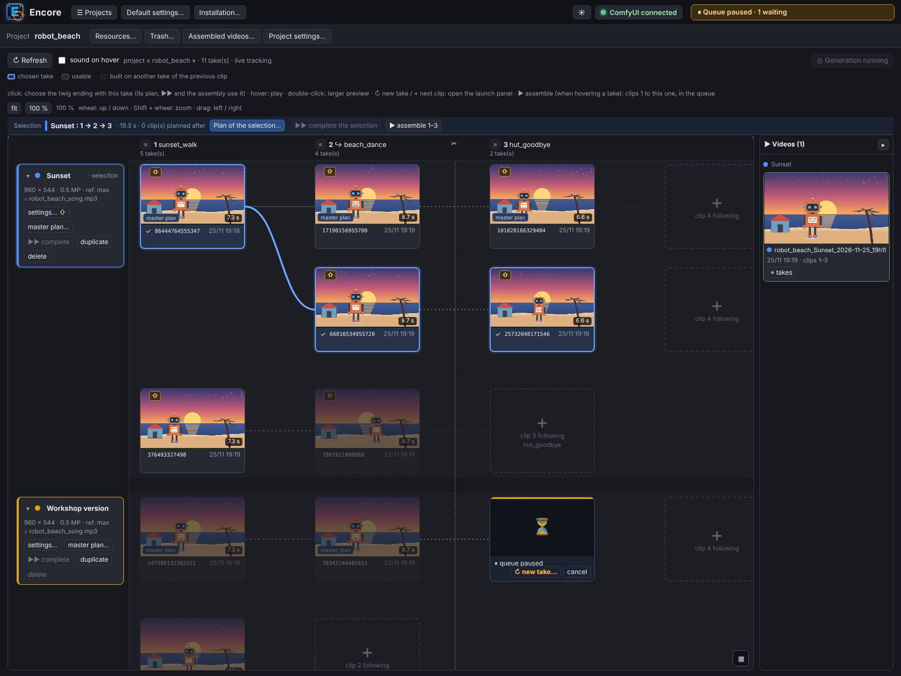
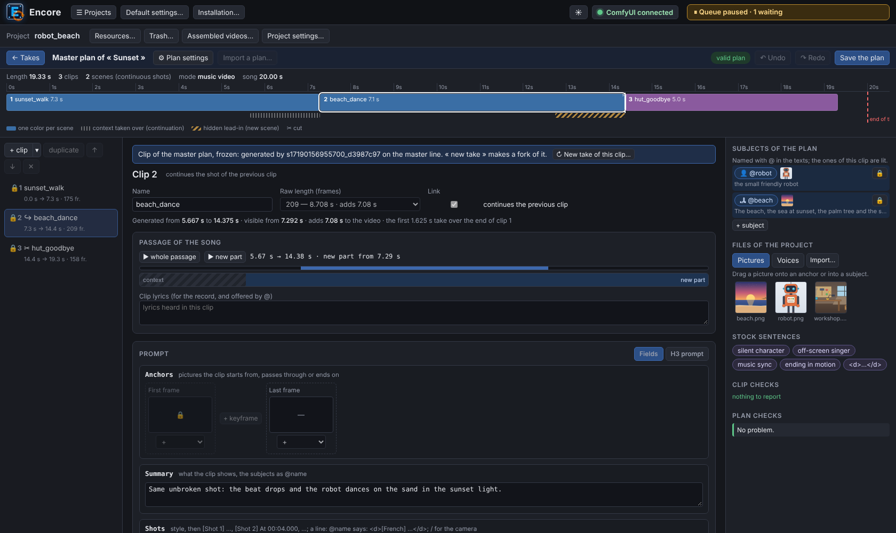
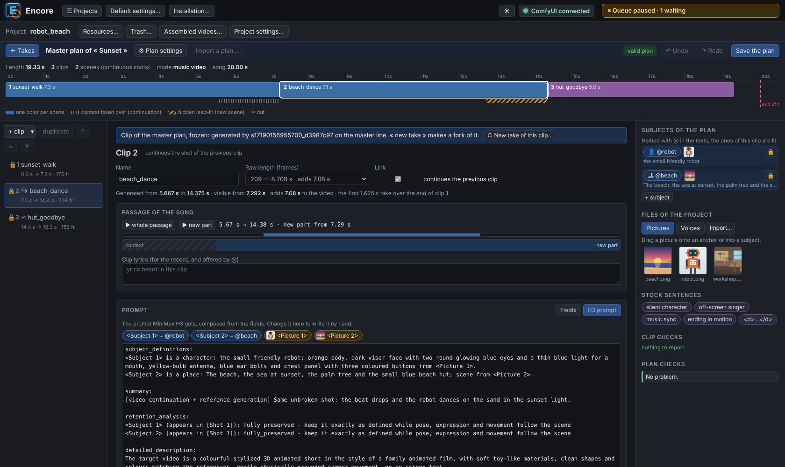
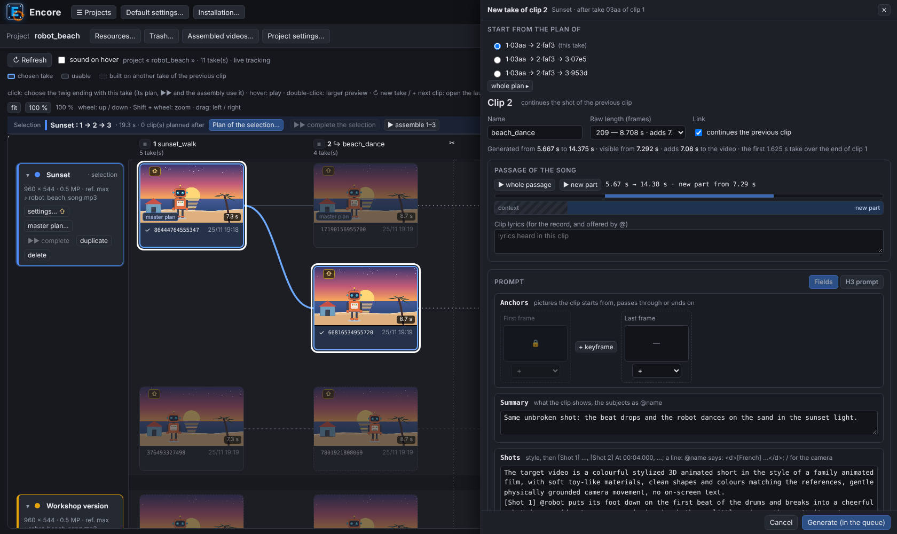
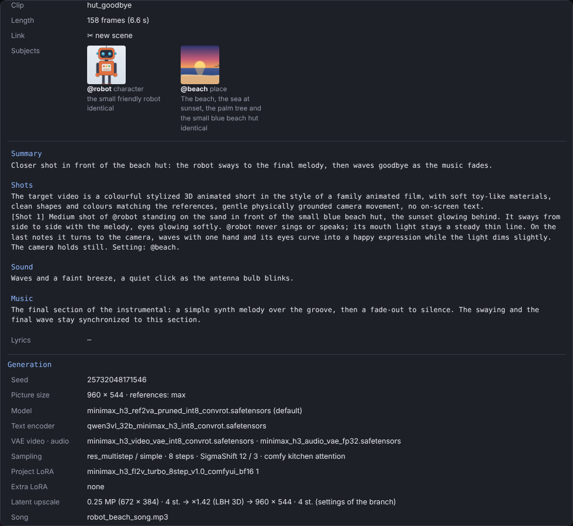
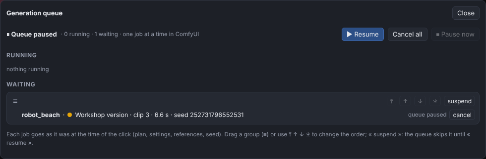

<p align="center">
  
</p>

<h1 align="center">Encore</h1>

<p align="center">
  <b>Un studio local pour clips musicaux et courts métrages MiniMax H3, piloté via ComfyUI.</b><br>
  Plans, branches, prises, file de générations et assemblage, dans votre navigateur.
</p>

<p align="center">
  <a href="LICENSE"></a>
  
  
  <a href="README.md"></a>
</p>

> **Avertissement : ce projet est entièrement « vibe-codé ».** Tout son code, sa documentation et
> ses tests ont été écrits par un assistant IA (Claude, d'Anthropic), à la demande de l'auteur.
> L'auteur a défini les fonctionnalités et testé le résultat à l'usage, mais n'a ni écrit ni relu
> le code. Lisez-le, testez-le sur votre propre installation et utilisez-le à vos risques ; les
> signalements et corrections sont les bienvenus.



## Ce que fait Encore

[MiniMax H3](https://huggingface.co/Comfy-Org/MiniMax-H3) produit des clips d'une dizaine de
secondes, image et son, à partir d'images de référence. Un clip musical ou un court métrage est
une suite de tels clips qui s'enchaînent. Encore décrit cette suite dans un **plan** (un fichier JSON :
les sujets et les fichiers, les clips l'un après l'autre, quel clip continue lequel, la chanson ; format
dans [docs/PLAN_SPEC.md](docs/PLAN_SPEC.md), en anglais) et en est l'application. ComfyUI fait toute
l'inférence : Encore compose les prompts, prépare les fichiers et envoie à ComfyUI des workflows faits de
ses nœuds natifs et de ceux de deux paquets de nœuds (voir [Prérequis](#prérequis)). Ce qu'il offre :

- **Éditeur de plan** : les clips sur une frise au-dessus de la chanson ; des sujets (un personnage,
  un lieu, un objet…) avec leurs images et leur voix, nommés `@nom` dans des champs simples ; Encore
  écrit le prompt dans la forme propre à MiniMax (numéros, définitions, rétention, tâche) et le montre,
  modifiable ; contrôles du plan et de chaque clip.
- **Prises en arbre** : chaque génération est une prise ; une suite est construite sur la prise
  exacte qu'elle continue. Essayez plusieurs prises, gardez la meilleure chaîne (une *brindille*),
  revenez à une plus ancienne. Chaque brindille a son propre plan : les clips déjà générés sont
  figés, les suivants restent modifiables.
- **Branches** : le même plan avec d'autres images, une autre taille, d'autres LoRA ou réglages
  d'upscale, côte à côte, sans mélanger leurs prises.
- **File de générations** : un travail à la fois dans ComfyUI, survit à un redémarrage de ComfyUI
  ou d'Encore, réordonnable, en pause et reprise ; **▶▶ compléter** remplit toute une branche.
- **Upscale latent** (optionnel) : générer petit, puis agrandir dans une seconde passe.
- **Assemblage** : un clic met bout à bout les prises choisies sur la chanson en une vidéo.
- **Fenêtres de plan** qui disent exactement comment une prise a été
  faite, un écran d'installation qui installe les packs de nœuds et télécharge les modèles,
  anglais et français, thèmes sombre et clair.

ComfyUI ne sert que de moteur : Encore lui parle à son adresse et ne modifie jamais ses workflows.

## Captures d'écran

**Éditeur de plan : le plan maître d'une branche qui a des prises, ses clips figés (🔒, faits par la ligne du plan maître), les champs du clip 2, les sujets et fichiers à droite**



**Le même clip, onglet « Prompt H3 » : ce que reçoit MiniMax H3, composé à partir des champs, avec ses numéros**



**Panneau de lancement : une nouvelle prise du clip 2, par-dessus les prises ; de quelle brindille partir, le clip, la graine**



**Fenêtre de plan ≡ d'une prise : le plan avec lequel elle a été faite et tout ce qui a servi à la générer**



**File des générations : réordonner, suspendre, mettre en pause, reprendre**



*(Captures faites avec l'exemple du robot du dossier `examples/`, interface en anglais ; les prises y sont des
animations de remplacement, pas de vrais rendus H3.)*

## Prérequis

- **Windows** ou **Linux** (Mac non pris en charge pour l'instant), **Python 3.10** ou plus récent.
- Un **[ComfyUI](https://github.com/comfyanonymous/ComfyUI)** qui fonctionne, avec la prise en
  charge de MiniMax H3, sur ce PC ou joignable sur le réseau, et **git** (pour les packs de nœuds).
- Les packs de nœuds ci-dessous ; l'écran d'installation d'Encore peut les installer pour vous :
  [ComfyUI-H3-Motion-Context-MultiRef](https://github.com/seitanism/ComfyUI-H3-Motion-Context-MultiRef)
  (prises gardées pour être continuées, raccords, chanson, vidéos) et
  [ComfyUI-VideoHelperSuite](https://github.com/Kosinkadink/ComfyUI-VideoHelperSuite) (vidéos) ;
  optionnels : ComfyUI-KJNodes (aperçu animé), les nœuds d'upscale latent LBH (upscale). Depuis la 0.50,
  Encore n'utilise plus ComfyUI-H3-ClipPlan.
- **ffmpeg**, trouvé par Encore (celui de VideoHelperSuite dans le Python de ComfyUI, ou dans le PATH) : il
  coupe les voix et les morceaux de vidéo qu'il envoie, et assemble les vidéos.
- Les modèles H3 (modèle de diffusion, encodeur de texte, VAE, LoRA turbo) : l'écran
  d'installation télécharge ceux par défaut.

Encore lui-même n'utilise que la bibliothèque standard de Python : rien à installer avec `pip`.

## Démarrage rapide

1. Récupérer Encore : `git clone https://github.com/timpatim/Encore.git`, ou **Code > Download
   ZIP** sur GitHub puis décompresser (où vous voulez, pas dans ComfyUI).
2. L'installer et le lancer (détails dans [Installation d'Encore](#installation-dencore)) : sous
   Windows, double-cliquer `install.bat` puis `Encore.bat` ; sous Linux, `./install.sh` puis
   `./encore.sh`. Encore ouvre `http://127.0.0.1:8190` dans le navigateur.
3. **Écran de bienvenue** : donner l'adresse et le dossier de ComfyUI, installer les packs de nœuds
   manquants, redémarrer ComfyUI, télécharger les modèles par défaut.
4. **☰ Projets > Nouveau projet** : un nom, mode *libre* (H3 fait l'image et le son) ou *clip
   musical* (une chanson est posée sous les clips).
5. **plan maître…** (en-tête de branche), puis **Importer un plan…** : un plan écrit à la main, par un
   LLM (avec le [prompt système](docs/LLM_SYSTEM_PROMPT.md) de `docs/`) ou l'un des `examples/`. Ou
   l'écrire là.
6. **Ressources…** : importer les images (et la chanson ou les voix) ; la chanson se choisit dans
   **Réglages du projet**. Sur l'écran de plan, donner ses images à chaque sujet du plan (✎ sur le sujet,
   ou déposer dessus une image des « Fichiers du projet »).
7. Sur l'écran des prises : la ligne du haut de la branche est sa **ligne du plan maître**, une case par
   clip du plan maître ; cliquer la première pour la générer, ou **▶▶ compléter** pour mettre toute la
   ligne en file. **↻ nouvelle prise…** et **+ clip suivant…** en font des variantes. Cliquer une prise
   pour la choisir.
8. Survoler la dernière prise : **▶ assembler 1–k** fait la vidéo ; elle apparaît dans le volet
   **▶ Vidéos**.

La suite de cette page est le guide complet.

# Guide d'utilisation

*Encore s'appelait « H3 Studio » jusqu'à sa version 0.16.* L'adresse de ComfyUI est
`http://127.0.0.1:8188` par défaut.

Messages, confirmations et saisies s'ouvrent dans une fenêtre d'Encore, au centre de l'écran
(Entrée valide, Échap annule ; pour une suppression, « Non » a le focus).
Seul l'avertissement de fermeture de l'onglet avec un plan non enregistré reste celui du navigateur.

## Langue

Encore est en anglais par défaut. Page d'accueil > **Réglages par défaut…** > **Langue** : la page
se recharge dans la langue choisie, messages du serveur, fiches `.infos.md` et libellés de la file
compris (ce qui a déjà été écrit, comme un nom de branche, reste tel quel).

Les textes sont dans `encore/locales/<code>.json` (`en.json`, `fr.json`) : `{"identifiant": "texte"}`,
avec des valeurs `{nom}` remplacées à l'affichage. Pour ajouter une langue, copier `en.json` en
`de.json` par exemple, traduire les textes et la clé `_name` (nom affiché dans la liste) : elle
apparaît au prochain lancement. Un texte absent d'un fichier s'affiche en anglais. Les termes de H3
(`subject_definitions`, `fully_preserved`…) et le contenu des prompts ne se traduisent pas.

## Thème clair ou sombre

Sombre par défaut. Le bouton **☀ / ☾** de la barre du haut bascule tout de suite ; le choix est aussi
dans **Réglages par défaut… > Thème**, et il est gardé dans `config.json`. Les pages d'infos des
vidéos le suivent. La feuille de style claire est déduite de la sombre à la construction de la page
(`encore/theme.py`).

## Installation d'Encore

Encore n'utilise que la bibliothèque standard de Python : aucun paquet à télécharger.

**Avec venv** (Python 3.10 ou plus récent installé sur le PC) :

1. Mettre le dossier `Encore` où vous voulez (pas dans ComfyUI) : `git clone https://github.com/timpatim/Encore.git`,
   ou télécharger le ZIP sur GitHub et le décompresser.
2. Double-cliquer `install.bat` : crée l'environnement `.venv` dans ce dossier.
3. Double-cliquer `Encore.bat` : lance Encore et ouvre `http://127.0.0.1:8190`.

**Avec conda** :

```text
conda env create -f environment.yml
conda activate encore
Encore.bat
```

**Sous Linux** (Python 3.10 ou plus récent, avec le module venv : `sudo apt install python3-venv`
sur Debian/Ubuntu) :

```bash
./install.sh     # crée .venv dans le dossier
./encore.sh      # lance Encore (ou, avec conda : conda activate encore puis ./encore.sh)
```

Le Mac n'est pas pris en charge pour l'instant (on peut essayer `python3 -m encore` depuis le
dossier, sans garantie).

Options de lancement : `Encore.bat --port 8191` (ou `./encore.sh --port 8191`), `--no-browser`.
La fenêtre de console doit rester ouverte pendant l'utilisation ; Ctrl+C l'arrête.

**Vous aviez H3 Studio ?** Décompressez `Encore` à côté du dossier `H3Studio` (dans le même dossier
parent) : au premier lancement, Encore reprend `config.json`, `defaults.json` et la file
(`queue.json`). Les projets ne bougent pas.

## Premier lancement : l'écran « Bienvenue dans Encore »

Encore ne va pas plus loin tant que ComfyUI n'a pas tout ce qu'il faut. L'écran se rouvre plus
tard par le bouton **Installation…** de la barre du haut (sans bloquer).

1. **ComfyUI** : son adresse, et son **dossier d'installation** (celui qui contient `custom_nodes`
   et `models` ; pour la version portable, le dossier `ComfyUI_windows_portable` suffit).
   Encore trouve le **Python de ComfyUI** : `python_embeded` (version portable), `.venv` ou `venv`
   (installation manuelle, application Desktop). Sinon, indiquez le chemin de son `python.exe`
   (conda par exemple) ; « Vérifier » le lance et contrôle que torch est là. Il faut aussi **git**
   (Git pour Windows, git-scm.com). L'écran montre aussi le **ffmpeg** trouvé par Encore (pour couper
   les voix et les morceaux de vidéo qu'il envoie, et pour assembler) : celui qu'apporte
   VideoHelperSuite dans le Python de ComfyUI, ou celui du PATH.
2. **Custom nodes** : la liste des paquets qu'Encore utilise, avec leur état (chargé, installé
   mais ComfyUI pas encore redémarré, absent). Les obligatoires
   (ComfyUI-H3-Motion-Context-MultiRef, ComfyUI-VideoHelperSuite) sont
   cochés d'office ; les facultatifs (ComfyUI-KJNodes pour l'aperçu animé, nœuds LBH pour
   l'upscale) se cochent au choix ; un paquet déjà présent dans ComfyUI est coché d'office, sans
   pouvoir être décoché. Chaque nom est un lien vers le dépôt du paquet : **vous pouvez aussi
   installer les paquets vous-même** (ComfyUI-Manager, git clone…), Encore les détecte au
   redémarrage de ComfyUI. **Installer** fait un `git clone` dans `custom_nodes` puis
   installe les dépendances (`requirements.txt`) avec le Python de ComfyUI (`-s` pour la version
   portable), sans passer par ComfyUI-Manager. Le journal s'affiche dessous. Un paquet déjà
   présent est reconnu à son nom de dossier ou à l'adresse de son dépôt git. Un dossier
   ComfyUI-H3-ClipPlan encore dans `custom_nodes` est signalé : Encore ne s'en sert plus depuis la
   0.50 (gardez-le si vous l'utilisez directement dans ComfyUI).
3. **Redémarrez ComfyUI** : Encore ne le redémarre pas lui-même. Il détecte sa coupure puis son
   retour, relit la liste des nœuds, et le bouton **Continuer** s'active quand tous les paquets
   obligatoires sont chargés.
4. **Modèles par défaut** (facultatif ici) : voir plus bas.

La liste des paquets est dans `encore/data/node_packs.json` (nom, dépôt git, dossier, nœuds
attendus, obligatoire ou non) : on peut en ajouter sans toucher au code.

## Modèles par défaut : téléchargement

Dans l'écran d'installation, et dans les réglages (bouton **⬇ télécharger le modèle par
défaut** sous une liste de modèles quand le fichier par défaut n'est pas dans ComfyUI) :

- modèle de diffusion ref2va pruned int8, encodeur de texte Qwen3-VL 32B int8, VAE vidéo et
  audio, LoRA turbo 8 étapes (dépôt Hugging Face `Comfy-Org/MiniMax-H3`), et le modèle d'upscale
  LBH 3D (`LBH-123-AI/Minimax_h3_latent_Upscaler`) ;
- chaque fichier va dans son sous-dossier de `ComfyUI/models` ;
- **avant de commencer**, Encore lit la taille réelle du fichier sur Hugging Face et la compare
  à l'espace libre du disque, avec 2 Go de marge et en comptant les téléchargements en cours ;
  s'il manque de la place, il refuse en donnant les chiffres ;
- progression, vitesse, annulation ; un téléchargement interrompu reprend où il s'était
  arrêté (fichier `.part`) ;
- un dépôt protégé demande un jeton Hugging Face (`hf_token` dans `config.json`).

La liste est dans `encore/data/models.json`.

## Connexion à ComfyUI

Pastille permanente dans la barre du haut : verte « ComfyUI connecté », orange « reconnexion… »,
rouge « ComfyUI injoignable ». Un clic : adresse, version, depuis quand, « Réessayer ». Les
générations lancées pendant une coupure attendent dans la file. Au retour de ComfyUI (après un
redémarrage), Encore relit les listes de nœuds et de modèles.

## Un projet

```text
<dossier des projets>\<nom>\
  project.json      réglages : ce qu'est la vidéo (mode, vidéo, chanson, contexte), modèles, branches
  plans.json        le plan maître de chaque branche et le plan de la suite de chaque prise
  refs\images\      images importées
  refs\voices\      voix importées
  refs\songs\       chansons importées
  refs\videos\      vidéos importées (vidéo de départ ou éditée)
  takes\clip_NNN\  prises : latent (.pt), signature (.json), aperçu (.mp4)
  selection.json    la brindille sélectionnée (prise choisie des clips 1 à k, chacune continuant la précédente)
  jobs.json         générations en attente (présent seulement pendant qu'il y en a)
  exports\          vidéos assemblées (.mp4) et leur fiche (.json)
  trash\            ce qui a été supprimé, jusqu'à sa restauration ou son effacement (Corbeille…)
  store\            (réservé)
```

- **☰ Projets** : liste, création (nom = nom du dossier ; mode libre ou clip musical). **🗑** sur la
  carte d'un projet le supprime **définitivement** (pas de corbeille) : la confirmation compte ses
  prises, ses vidéos assemblées et sa taille sur le disque ; ses copies dans les dossiers `input` et
  `output` de ComfyUI partent aussi. Refusé tant qu'une de ses générations ou assemblages attend ou tourne.
- **Importer un plan…** (sur l'écran du plan maître d'une branche) : le fichier remplace le plan maître
  d'une branche qui n'a encore aucune prise ; grisé dès qu'elle en a (créer une nouvelle branche « à
  partir d'un fichier de plan »). Les graines du fichier sont ignorées. Tant que le projet n'a aucune
  prise, le mode, la vidéo et le contexte du plan deviennent ceux du projet.
- **Ressources…** : importe des images, voix, chansons et vidéos (copiées dans `refs\`), par ses boutons
  ou en déposant des fichiers de l'ordinateur (un fichier audio va dans la section où on le dépose, sinon
  Encore demande voix ou chanson) ; on peut aussi déposer des fichiers sur « Fichiers du projet » dans la
  bibliothèque. Un gros fichier
  affiche une fenêtre de progression (annuler ne laisse rien derrière) ; il est écrit au fil de l'eau. Quand le
  dossier de ComfyUI est connu (écran de bienvenue), les fichiers sont ensuite copiés directement dans
  son dossier `input`, sans limite de taille ; sinon ils passent par la route d'envoi de ComfyUI, qui
  refuse les fichiers de plus de 100 Mo sauf si ComfyUI est lancé avec `--max-upload-size` (la file
  affiche « envoi de … à ComfyUI »). Une vidéo que le navigateur ne sait pas lire (AVI, ProRes,
  HEVC…) reçoit une copie légère en H.264 pour les lecteurs seulement, faite par ffmpeg (celui du
  Python de ComfyUI, ou du PATH) avec sa progression ; ComfyUI reçoit toujours l'original. Chaque fichier
  affiche son état : **utilisé** (par un plan, la chanson ou la vidéo du projet, ou une génération en
  attente), **seulement des prises** (seules des prises déjà faites l'ont utilisé) ou **inutilisé**. 🗑
  supprime un fichier : refusé tant qu'un plan, la chanson, la vidéo ou une génération en attente
  l'utilise (le message dit où), après un avertissement qui liste les prises qui en ont encore besoin,
  tout de suite sinon. **Supprimer les inutilisés** les supprime tous d'un coup, après confirmation. Leur
  copie dans ComfyUI part aussi quand le dossier de ComfyUI est connu. Un fichier
  identique n'est pas copié deux fois. Images acceptées : PNG, JPEG, WebP, BMP ; le contenu est vérifié, et les JPEG
  en `.jfif`, `.jfi`, `.jpe`, `.pjpeg` ou `.pjp` sont enregistrés en `.jpg` (octets identiques).
- **Réglages du projet…** : d'abord **le projet** : mode (clip musical ou libre), vidéo (aucune,
  continuer une vidéo, éditer une vidéo) et son fichier, chanson (clip musical), contexte. Ils sont les
  mêmes pour toutes les branches et se figent avec la première prise du projet (grisés, avec la raison).
  Puis qualité des aperçus, modèles et échantillonnage, aperçu en direct. Boutons « Enregistrer comme
  réglages par défaut » et « Reprendre les réglages par défaut ».

## Écran des prises et écran de plan

L'**écran des prises** est l'écran principal : branches, prises, file, vidéos assemblées. Le plan se
modifie sur l'**écran de plan**, ouvert depuis lui, qui le remplace jusqu'à **← Prises** (le plan est
enregistré au retour s'il a été modifié). L'écran de plan a sa propre ligne, sous celle du projet :
**← Prises**, ce qu'il montre (● tant que des modifications ne sont pas enregistrées), **⚙ Réglages du
plan**, puis **↶ Annuler**, **↷ Rétablir** et **Enregistrer le plan**, qui agissent sur le plan affiché.
Les boutons du projet (Ressources, Corbeille, Vidéos assemblées, Réglages du projet) restent sur la ligne
du dessus :

- **plan maître…** (en-tête de branche) : le patron de départ de la branche ; sa ligne du plan maître le
  suit. **Dès que la branche a une prise** (ou une génération en attente), **il est figé** : ses clips
  sont en lecture seule (🔒, avec la prise de la ligne du plan maître qui les a faits), comme ses sujets
  (🔒 dans la bibliothèque : leur fenêtre les montre sans « Enregistrer »), avec les fichiers qu'ils
  utilisent. On peut encore ajouter des clips à la fin (libres tant que la ligne ne les a pas générés) et
  de nouveaux sujets pour eux. Pour changer le reste, dupliquer la branche (sans ses clips : le plan
  maître de la copie est libre).
- **Plan de la sélection…** (barre de sélection, au-dessus du graphe) : le plan de la brindille
  sélectionnée. Les clips déjà générés y portent 🔒 et sont en lecture seule (leur prompt est celui
  avec lequel la prise a été faite) ; on peut ajouter, modifier ou retirer des clips après eux. Les
  changements restent dans cette brindille : le plan maître et les autres brindilles ne changent pas.
  **Nouvelle branche avec ce plan…** en fait le plan maître d'une nouvelle branche avec les réglages de
  celle-ci (aucun clip repris) : pour essayer ailleurs des prompts qui marchent. Un plan maître n'est
  jamais remplacé quand sa branche a des prises.

**Plans d'une branche.** Une branche a un plan maître et une **ligne du plan maître** : les prises faites
à partir du plan maître lui-même, une par clip, en ligne en haut de sa bande (étiquette « plan maître »),
suivies de cases vides pour les clips pas encore générés. Une case de la ligne se génère une seule fois,
dans l'ordre (on clique la première case vide, ou ▶▶) : un changement passe par **↻ nouvelle prise…**,
qui fait une variante. Après une prise de la ligne vient le plan maître lui-même. Chaque autre prise a le
plan de ce qui vient après elle (sa *suite*) : une nouvelle prise du clip k enregistre les clips k+1 à la fin avec lesquels elle a été
lancée. Le plan d'une brindille, c'est la partie figée de chacune de ses prises, puis la suite de sa
dernière prise. Rien n'est recopié : une bifurcation référence les prises qu'elle continue. Dès qu'une
branche a une prise, les réglages du plan qui rendraient ses prises incohérentes (mode, vidéo de départ
ou éditée, contexte) sont figés ; les options d'assemblage (vidéo de départ dans la vidéo finale, son et
consigne commune d'une édition) ne le sont pas.

Trois colonnes : la liste des clips, l'éditeur du clip, et à droite la bibliothèque (sujets du plan,
fichiers du projet, phrases types) et les contrôles. Les réglages du plan (mode, contexte, fondu,
chanson, vidéo) sont dans **⚙ Réglages du plan**.

**Sujets et fichiers.** Un plan a des **sujets** : un personnage, un lieu, un objet, une tenue, un
style, une action ou une pose. Chacun a un nom (`@robot`), un genre, une description en anglais, autant
d'images que nécessaire (chacune avec ce qu'elle apporte : visage, tenue, décor… ; une même image peut
servir à plusieurs sujets) et, en mode libre, une voix. **+ sujet** ou ✎ ouvre sa fenêtre ; on peut y
déposer une image des « Fichiers du projet » ou un fichier de l'ordinateur ; un clic sur la vignette d'une
image la remplace (son rôle conservé), par une image du projet ou importée directement. Les fichiers sont
ceux du projet (**Ressources…**) ; le plan les nomme par une étiquette faite automatiquement d'après le nom
du fichier.

**Images à fournir.** Un plan importé avec des labels mais sans fichiers (écrit ailleurs, par exemple)
montre chaque image manquante en cadre pointillé avec son label et sa note, et les liste dans la section
« Images à fournir » de la bibliothèque. Choisir ou importer (ou déposer) une image remplit le label : son
nom, sa note et son rôle sont gardés, et les clips qui l'utilisent restent justes.

**Les champs d'un clip** (onglet « Champs ») : du texte simple, les sujets nommés `@nom`.

- **Ancres** : l'image dont part le clip (première image ; pas sur un clip qui continue le précédent),
  des images clés à une seconde donnée, l'image sur laquelle il finit (dernière image). Choisir un
  fichier dans la liste ou en déposer un depuis la bibliothèque.
- **Résumé** : ce que montre le clip. **Plans** : le style, puis `[Shot 1] …`, `[Shot 2] At 00:04.000 …`.
  **Son** et **Musique** : l'ambiance, la musique (en clip musical, le passage de la chanson).
- **@ et glisser-déposer** : taper `@` ouvre une liste filtrée (sujets, répliques ou paroles, phrases
  types, « créer @nom ») : flèches, Entrée ou Tab, Échap. Un sujet se glisse dans n'importe quel texte.
- **/ pour la caméra** : taper `/` dans un texte ouvre le vocabulaire caméra de MiniMax : mouvements
  (travelling avant, panoramique, tilt, arc, suivi…) suivis de leur amplitude et de leur vitesse, coupes
  vers un nouveau plan, cadrages (gros plan, plan large, par-dessus l'épaule…). La phrase est écrite en
  anglais à l'endroit du curseur.
- **Répliques** (mode libre) : `@nom says: <d>[French] …</d>`. Le locuteur de chaque réplique est
  trouvé tout seul : le sujet nommé dans sa phrase, ou celui du dialogue du clip dont le texte
  correspond. Les locuteurs sont numérotés S1, S2… dans l'ordre où ils parlent ; n'écrire `@nom (S)` que
  pour choisir un autre locuteur.
- **Sujets du clip** : les sujets que ses textes nomment, chacun avec la fidélité à ses images
  (identique, partiel, seulement l'attribut, vague inspiration), la fidélité à sa voix, et une note pour
  ce clip seulement (« porte une casquette »). Un compteur montre les images, voix et fichiers utilisés
  par rapport aux limites de H3 (9 images, 3 voix, 12 fichiers).

**L'onglet « Prompt H3 »** montre ce que recevra MiniMax H3, composé par Encore à partir des champs :
sujets numérotés `<Subject N>` dans l'ordre où ils apparaissent, images `<Picture N>`, voix
`<Audio N>`, les définitions, la rétention de chaque sujet, le préfixe de tâche (`[video continuation +
reference generation]`…) et la phrase d'ouverture imposée d'une continuation ou d'une nouvelle scène.
Les pastilles au-dessus donnent chaque numéro. Le texte peut être **modifié à la main** : il est alors
envoyé tel quel (✎ sur l'onglet) et les champs ne le changent plus ; « Revenir au prompt composé »
l'annule. Dans un texte écrit à la main, `@nom` marche toujours et reçoit son numéro.

- **« ↺ du clip précédent »** sur le style, le son et la musique.
- **+ clip** reprend les sujets et les textes du clip sélectionné ; ▾ propose un clip vide.
- **Passage de la chanson** (clip musical) : « ▶ tout le passage » (chevauchement compris) et
  « ▶ partie nouvelle », lus dans la chanson de la branche ; barres du passage dans la chanson et
  du chevauchement. Les paroles du clip sont dessous.
- Un clip déjà généré (🔒, plan d'une sélection) garde les sujets et fichiers avec lesquels il a été
  fait, même si le plan les change ensuite.

Partout dans l'application, une liste déroulante d'au moins 8 éléments (LoRA, modèles…) s'ouvre
avec un champ de filtre (plusieurs mots possibles), flèches et Entrée.

## Réglages par défaut

Page d'accueil > **Réglages par défaut…** : le modèle des réglages (modèles, LoRA,
échantillonnage, aperçus), la taille d'image et la taille des références de la première branche. Chaque nouveau projet en
reçoit une copie à sa création ; ils ne servent à rien d'autre et ne changent pas les projets
existants. Enregistrés dans `defaults.json`, à côté de `config.json`. **LoRA** : une liste (« + ajouter un LoRA ») ; chaque
  LoRA a sa force et une case pour le désactiver sans le retirer ; ils sont appliqués l'un après
  l'autre. Les LoRA et modèles utilisés sont notés dans chaque prise (visibles dans l'aperçu
  agrandi) ; les changer ne supprime pas les prises. Les listes de modèles viennent de ComfyUI quand il
  répond ; sinon les noms se saisissent à la main.
- **Enregistrer** (Ctrl+S, écran de plan) : enregistre le plan affiché (plan maître ou plan de la sélection).
- **↶ ↷** (Ctrl+Z / Ctrl+Y) : annuler et rétablir les modifications du plan, sur l'écran de plan et dans le
  panneau de lancement seulement (sur l'écran des prises, ils ne font rien).

## Branches

Le projet dit ce qu'est la vidéo (mode, vidéo, chanson, contexte : **Réglages du projet**). Les
**branches** en essaient des variations : taille d'image, segment de la vidéo, LoRA, upscale, et leur
plan maître (sujets avec leurs images et leurs voix, prompts). Elles se règlent dans la fenêtre **réglages…** de la
branche (un bouton dans son en-tête). La taille : préréglages par format (16:9,
9:16, 4:3, 3:4, 3:2, 2:3) et mégapixels (0,2 à 2 ; 0,5 MP par défaut, soit 960 × 544 en 16:9 ; mêmes tailles que ComfyUI,
1 MP = 1024 × 1024 pixels), ou taille libre en multiples
de 32. Une branche à 0,2 MP permet de tester vite un prompt avant une branche à 1 MP (une même
graine ne donne pas la même vidéo à une autre taille). Le même écran règle la **taille des
références** (`max` par défaut, ou `match`), passée à l'encodeur de références H3 : ce n'est plus un
champ du plan (`ref_image_size` est retiré du plan à l'import ou à l'enregistrement). Plusieurs branches
permettent d'essayer d'autres images, voix ou tailles en parallèle : donner d'autres images aux sujets du
plan maître de chaque branche. **Dès qu'une branche a une prise, sa taille et le segment de sa vidéo
sont figés** : grisés dans les fenêtres, avec une infobulle qui dit pourquoi. Pour d'autres valeurs,
dupliquer la branche. LoRA, upscale et taille des références restent toujours modifiables. Les prises
gardent les sujets et fichiers avec lesquels elles ont été faites.

- Un nouveau projet a « Branche 1 », avec un plan maître vide. **+ nouvelle branche** ouvre une
  fenêtre :
  - **Vide** : réglages et plan maître de la dernière branche créée ;
  - **À partir d'un fichier de plan…** : son plan maître est le fichier.
- **dupliquer** (en-tête de branche) : une nouvelle branche avec ses réglages et son plan maître, **sans
  clips** (son plan maître redevient modifiable jusqu'à sa première prise), ou **avec des clips de la
  sélection** : la fenêtre montre la sélection en petites vignettes, scène par scène (✂ entre elles). Les
  clips repris forment des **portions**, chacune depuis le début d'une scène : un clic sur un clip le reprend
  avec sa scène depuis son début, un clic sur un clip repris le laisse libre avec la suite de sa scène (un clip
  qui en continue un autre n'est jamais repris sans lui). Pour 1→2→3 | 4→5→6 | 7→8→9 : 1→2→3 et 7→8→9, ou
  1→2, 4→5 et 7→8, ou 1, 4→5 et 7. Ils sont repris par référence (aucun fichier copié), estompés dans la
  nouvelle bande (« ⇡ Branche 1 »), et sa ligne du plan maître fait les clips laissés libres : une case vide
  pour chacun, les clips repris après elle s'y accrochent. Les clips laissés libres partent du plan de la
  sélection et restent modifiables dans le plan maître (jusqu'à ce que la ligne du plan maître les fige) ; leur
  durée et leur lien sont verrouillés, dans le plan maître et dans le panneau de lancement, pour que les
  portions d'après restent à leur moment de la chanson ; un clip repris après un clip laissé libre attend
  celui-ci (ses ↻ et + sont grisés). Son plan maître est le
  plan de cette sélection, avec ses sujets ; les clips repris gardent les sujets et fichiers avec
  lesquels ils ont été faits ; ↻ nouvelle prise… et + clip suivant… fonctionnent sur eux, la nouvelle prise
  étant une variante de la branche dupliquée (la branche d'origine ne change pas). Une branche dont des
  prises sont reprises par une autre ne se supprime pas avant elle.
  Créer une branche ne lance aucune génération.
- Chaque branche est une bande horizontale (un arbre), avec à gauche sa couleur, son nom (un champ :
  taper le nouveau nom, Entrée ou un clic ailleurs l'enregistre, Échap remet l'ancien), sa taille et sa
  chanson.
- **supprimer** (en-tête de la branche, impossible pendant une génération de la branche) : met ses prises,
  ses plans et ses vidéos assemblées à la corbeille, après une alerte qui les compte. Les prises qu'une
  autre branche reprend restent (montrées dans cette branche). Un numéro de branche ne resert jamais.
- **🗑** (au survol d'une prise) : la supprime avec toutes les prises faites après elle, dans toutes les
  branches ; la confirmation les liste par clip et dit ce que garde une branche qui la reprenait. Refusé
  tant qu'une génération en file ou en cours a besoin de l'une d'elles.
- **Corbeille…** (barre du projet) : ce qui a été supprimé y attend. **Restaurer** remet un élément en
  entier (une prise avec sa suite, une branche avec ses prises, son plan maître et ses vidéos, les clips
  que d'autres branches reprenaient) ; **Effacer** ou **Vider la corbeille** supprime les fichiers pour de
  bon.
- **Les cases de la ligne du plan maître** : la première case vide (▶) ouvre le panneau de lancement de ce
  clip du plan maître, en lecture seule (graine, LoRA et upscale se règlent) ; les suivantes l'attendent.
- **+ clip suivant…** (sur une prise qui n'a pas encore de suite, même une prise encore en file, et
  dans la case en pointillés à sa droite, toujours présente, même après la fin du plan) : ouvre le
  panneau de lancement du clip suivant après cette prise, pré-rempli avec le clip suivant du plan de la
  sélection, sinon du plan maître, sinon une copie du clip précédent (textes, durée, sujets,
  répliques), qui le continue (↪).
- **↻ nouvelle prise…** (flèche orange sur une prise, aussi sur une génération encore en file ou en
  cours) : ouvre le panneau de lancement d'une nouvelle
  prise du même clip, après la même prise du clip précédent (sur le clip 1 : à partir du plan maître).
  C'est une bifurcation : une nouvelle brindille, avec son propre plan.
- **▶▶ compléter (en-tête de branche)** : remplit les cases vides de la ligne du plan maître de la
  branche, dans l'ordre. **▶▶ compléter la sélection** (barre de sélection) : génère la suite du plan de
  la brindille sélectionnée, après sa dernière prise (la sélection qui finit la ligne du plan maître,
  c'est la ligne du plan maître). Leur infobulle dit ce qu'ils feront (« générer les clips 5 à 16 »,
  « ligne du plan maître complète ») ; un récapitulatif
  (clips, durée estimée) demande confirmation, avec la case « assembler à la fin » (cochée par
  défaut). Graines aléatoires, réglages de la branche. Les générations de la branche déjà en file ou en
  cours ne le bloquent pas : la brindille passe par elles et la suite est mise en file après.
- **▶ assembler 1–k** existe aussi au survol d'une prise encore en file : l'assemblage est planifié
  et partira dès que cette génération (et celles dont elle dépend) seront finies.
- **La sélection** (clic sur une prise) est une brindille : la prise cliquée et celles qu'elle
  continue, jusqu'au clip 1. Les prises d'après qui la continuent toujours restent sélectionnées. La
  barre de sélection au-dessus du graphe la nomme et ouvre son plan. Choisir une prise d'une autre
  branche y fait basculer la sélection. Une génération encore en file ou en cours se choisit aussi : la
  sélection passe par la prise qu'elle fera.
- **Les nouvelles scènes (✂) suivent la sélection.** Une prise qui commence une nouvelle scène ne dépend
  pas des images d'avant : elle se rattache à la prise sélectionnée pour le clip précédent si elle y
  commence au même moment de la chanson (même durée avant elle ; en mode libre, toujours), et sa suite
  la suit. Exemple : 3a ✂ faite après 2a (5 s) ; choisir 2b (5 s aussi) : 3a passe sous 2b, et
  1 → 2b → 3a est une brindille, sans rien regénérer.

### Panneau de lancement

**↻ nouvelle prise…** et **+ clip suivant…** ouvrent le même panneau, par-dessus l'écran des prises :

- **Plan des clips suivants** : quand les brindilles qui passent par cette prise ont des plans différents
  pour les clips d'après, un choix par plan distinct : « Cette prise · le plan avec lequel elle a été faite »
  d'abord, puis chaque autre plan avec les prises de sa brindille en vignettes (la nouvelle prise en
  pointillé) et une étiquette jaune de ce qui change (« clip 3 modifié »). Le survol d'un choix surligne sa
  brindille dans le graphe ; « Lire le plan choisi en entier ▸ » l'affiche. Masqué quand toutes les
  brindilles gardent le même plan.
- **Graine** : tirée au hasard (🎲 pour une autre), pour une nouvelle prise aussi ; « ↺ graine de la
  prise refaite » remet sa graine (même graine et même prompt : Encore prévient que la prise sera
  identique).
- **LoRA et upscale** de cette prise (pré-remplis avec ceux de la prise refaite, ou ceux de la branche
  pour le clip suivant).
- **Le clip**, dans l'éditeur de plan : modifier son prompt avant de lancer. Seuls ce clip et les
  suivants peuvent changer ; la modification est gardée dans le plan de la nouvelle prise.
- **Générer** l'ajoute à la file.

Taper une autre graine dans le champ graine d'une prise + Entrée lance tout de suite une nouvelle prise
de ce clip, avec cette graine et les mêmes réglages.

### Replier une branche

La flèche ▾ en haut à gauche de l'en-tête d'une branche la replie : la branche devient un bandeau
fin (couleur, nom, nombre de prises, générations en attente ; pas de ▶▶). ▸ ou un
double-clic la déplie. Les branches repliées sont mémorisées par projet dans ce navigateur ; la vue
d'ensemble suit. Centrer la vue sur une prise d'une branche repliée (« ⌖ prises ») la déplie.
Au moins une branche reste toujours dépliée (la flèche de la dernière est grisée). Une branche repliée
n'a jamais la sélection : replier la branche de la sélection la fait passer à la première brindille (la
ligne du haut de l'arbre) de la première branche dépliée. Les bandeaux repliés ont tous la même largeur.

## Partir d'une vidéo existante

Un plan peut partir d'un segment d'une vidéo que vous avez déjà : le clip 1 la continue (même plan :
ses 1,6 dernières secondes sont reprises, image et, en mode libre, son) ou coupe après elle.

1. Dans **Réglages du projet** : vidéo « Continuer une vidéo » et son fichier (les vidéos importées du
   projet, ou **Importer…**). Une seule vidéo pour le projet : toutes les branches l'utilisent.
2. Dans **⚙ Réglages du plan > Vidéo** du plan maître d'une branche, choisir le segment dans le lecteur : « Segment de … à … », ou « ⇤ ici » / « ici ⇥ » à la position
   du lecteur ; « ▶ lire le segment » le lit. Le segment est aimanté sur la grille des images : sa
   fin est gardée, son début avance de moins de 0,7 s (la ligne en dessous dit ce qui est utilisé).
3. « le clip 1 continue la vidéo » ou « coupe après la vidéo », et si **le segment ouvre la vidéo
   finale** (sinon il ne sert que de tremplin : la vidéo commence avec le clip 1).
4. Clip musical, segment dans la vidéo finale : **la chanson commence avec la vidéo** (par défaut ;
   la vidéo perd son propre son et le clip 1 vient plus loin dans la chanson) ou **la vidéo garde son
   propre son et la chanson commence avec le clip 1**.

Le segment apparaît sur la frise de l'écran de plan avant le clip 1 (hachuré quand il n'est pas dans la
vidéo finale). Quand il ouvre la vidéo finale, l'écran des prises a une colonne **Vidéo de départ**
avant le clip 1 : le segment de chaque branche, relié aux prises du clip 1 qui le continuent
(survol : il se lit ; clic : ses réglages, sur l'écran de plan). Ce n'est pas une prise : il n'est ni
généré ni choisi. La vidéo est lue à 24 images/s, agrandie pour couvrir la taille d'image de la branche
et rognée au centre. Le fichier ne se change que tant que le projet n'a aucune prise ; le segment d'une
branche, tant qu'elle n'en a aucune.
Mettre ou non le segment dans la vidéo finale ne change rien en mode libre (en
clip musical, cela déplace la chanson sous les clips).

## Éditer une vidéo existante

Un plan en mode libre peut éditer un segment d'une vidéo que vous avez : changer son style, remplacer
un personnage par une image de référence, etc. La frise du plan est le segment ; chaque clip édite son
propre morceau, donné à H3 comme `<Video 1>` avec son son (les voix du clip viennent après, Encore les
numérote). Dans **Réglages du projet**, choisir la vidéo « Éditer une vidéo » et son fichier ; puis dans
**⚙ Réglages du plan > Vidéo** du plan maître d'une branche :

1. Choisir le segment, comme pour une vidéo de départ. Les branches doivent avoir les proportions de la vidéo, sinon son image est
   recadrée : Encore le signale et **leur donne les proportions de la vidéo** à la demande (à peu près
   le même nombre de pixels).
2. Le son de la vidéo finale : **le son d'origine du segment** (par défaut) ou **le son fait par H3**
   (pour changer une voix ou une réplique).
3. **✂ Découper sur les plans** : Encore trouve les changements de plan du segment (ffmpeg) et crée
   les clips : une nouvelle scène à chaque changement de plan, un plan plus long qu'un clip coupé en
   parts égales qui s'enchaînent (« clips d'au plus 10,1 s » par défaut). Les coupures tombent sur la
   grille où un clip peut finir ; on les déplace ensuite comme n'importe quel clip. Encore demande
   avant de remplacer les clips du plan.
4. Chaque clip reçoit des textes qui gardent le cadrage, les mouvements et le rythme de `<Video 1>`.
   On écrit l'édition une fois dans **✎ Consigne commune**, la première entrée de la liste des clips
   (aussi accessible depuis les réglages) : nommer les sujets avec `@` (« the man is replaced by
   @hero ») ; elle ouvre le résumé de chaque clip édité, que son propre résumé peut compléter (« the
   man also wears a red scarf »). L'entrée dit quels clips l'utilisent et quels sujets elle nomme.

**Continuer après le segment.** Les clips qui finissent avant la fin du segment éditent la vidéo (🎞 dans
la liste et sur la frise, qui montre la fin du segment) ; les suivants la continuent comme n'importe quel
clip : on les ajoute avec « + clip » après le dernier (pas de `<Video 1>` dans leur prompt). « Découper
sur les plans » ne remplace que les clips édités et garde ceux d'après. Avec le son d'origine, la vidéo
finale le garde sur la partie éditée seulement.

Un clip qui édite une vidéo dure de 2 à 15 s. Sur l'écran des prises, la carte vide d'un clip montre,
derrière le « + », la partie de la vidéo qu'il édite (survol : elle se lit). Le fichier se fige avec la
première prise du projet, le segment d'une branche avec sa première prise. Une vidéo de départ et une vidéo éditée ne se combinent
pas dans un même plan.

## File des générations (indicateur à droite de la barre du haut)

Encore garde sa propre file, commune à tous les projets, et n'envoie à ComfyUI qu'un travail à la
fois. Chaque génération ou assemblage est figé au moment du clic (plan, réglages, références, graine,
upscale) et envoyé quand vient son tour. La file survit à un redémarrage d'Encore.

- Groupes : un travail et ceux qui le continuent (« + clip suivant… » ou ↻ lancés sur un travail
  en attente). Leur ordre est fixe ; on déplace le groupe entier (glisser sa poignée ≡ : une ligne montre où il arrive et la liste défile à ses bords ; ou ⤒ ↑ ↓ ⤓).
- **Lots** : tout ce qu'un ▶▶ de branche lance (générations et assemblage final) forme un seul bloc,
  « ▶▶ Branche 1 : clips 3 à 16 + assemblage ». On le déplace, le suspend ou l'annule en entier ;
  au-delà de 5 travaux, la liste se replie. Une génération lancée à la suite d'un travail du lot le
  rejoint ; une autre génération passe après le lot (on peut la remonter).
- **Assemblage planifié** : il attend que toutes les générations dont il a besoin soient finies, et
  prend leurs prises à ce moment-là.
  Si une génération échoue, seuls les travaux qui en dépendent s'arrêtent (ses suites, et
  l'assemblage : « le clip 6 dont il dépend a échoué ») ; les clips d'une autre scène continuent.
  Relancer ▶▶ ne refait que les trous, assemblage compris.
- **Pause après le travail en cours** : il se termine, rien d'autre ne démarre.
- **Pause immédiate** : le travail en cours est interrompu et revient en tête de file ; il repartira
  du début, avec la même graine.
- **Suspendre** un groupe : la file le saute jusqu'à « reprendre ».
- **Annuler** : un travail, et ceux qui en dépendent (après confirmation). Si une génération échoue,
  celles qui en dépendaient sont retirées de la file.
- **Tout annuler** (en haut du gestionnaire) : toutes les tâches de la file, de tous les projets, celle en
  cours comprise, après confirmation.
- L'indicateur, toujours visible à droite de la barre « Encore » (largeur fixe : un texte trop long
  finit par « … », le texte entier est dans son infobulle), résume l'état d'un coup d'œil :
  « File vide » (gris), « ▶ génération · projet · clip · étape 3/8 · reste ≈ … · +n en attente »
  avec une barre de progression (vert), « ⏸ File en pause · n en attente » (orange),
  « ✖ échec » (rouge, jusqu'à ouverture du gestionnaire). Un clic l'ouvre. Le titre de l'onglet
  du navigateur reprend l'état (« ▶ 3/8 · … »), visible même depuis un autre onglet.
- Chaque travail affiche la longueur du clip à générer.
- ComfyUI peut avoir ses propres travaux : un travail envoyé par Encore attend alors derrière eux
  (« envoyé à ComfyUI, attend derrière n travail(aux) de ComfyUI »), et les estimations de début
  deviennent un minimum (« début dans … ou plus »). Annuler et « Pause maintenant » ne touchent que
  les travaux d'Encore : l'interruption désigne le travail d'Encore (les versions récentes de
  ComfyUI n'interrompent rien d'autre).

## Upscale latent (optionnel, par branche)

Fenêtre **réglages…** de la branche, « modifier… » à côté de l'upscale (⇧ sur le bouton quand il est
actif) : première passe à une taille
réduite (en mégapixels, mêmes proportions que la branche), upscale du latent, seconde passe à la
taille de la branche. Désactivé par défaut.

- Passe 1 : les N premières étapes de l'échelle des réglages (planificateur, nombre d'étapes,
  SigmaShift), ou une liste manuelle de niveaux de bruit.
- Upscaler : nœuds LBH-123-AI 3D ou 2D (pack `Comfyui_Minimax_h3_latent_Upscaler`), ou le nœud de
  ComfyUI (MiniMax H3 Latent Upscale With Model) ; modèle dans `models/latent_upscale_models`.
- Passe 2 : liste manuelle (défaut `0.9035, 0.8000, 0.6316, 0.3158, 0`, en 4 étapes) ou suite de
  l'échelle ; sampler et LoRA de la passe 2 réglables à part (par défaut ceux des réglages).
- Le raccord avec le clip précédent et la chanson sont remis tels quels avant la passe 2 (nœuds
  Separate/Concat AV Latent, Latent Cut, Replace Video Latent Frames de ComfyUI).
- Changer ces réglages ne modifie aucune prise ; les prises faites avec portent la marque ⇧ (détail
  au survol). Une prise seule peut utiliser d'autres réglages, ou aucun (voir plus bas).
- Temps restant estimé à part pour les générations avec upscale.

## LoRA et upscale par branche et par prise

La pile de LoRA des Réglages du projet s'applique toujours. On peut ajouter des LoRA « en plus » :

- **Branche** : dans sa fenêtre **réglages…** (⇧ et L sur le bouton quand ils sont actifs). Ajoutés à
  toutes les prises de la branche ; « modifier… » ouvre les réglages d'upscale de ses prises.
- **Prise** : dans le panneau de lancement (↻ nouvelle prise…, + clip suivant…) : la liste des LoRA et
  l'upscale, pour cette prise seulement. La ligne upscale est repliée et dit « comme la branche « X » »
  ou « modifié pour cette prise » ; **modifier…** déplie le formulaire complet (activé ou non, modèle,
  taille de départ, passes…), parti des réglages de la branche ; **réinitialiser aux paramètres de la
  branche** y revient. Depuis ↻, le panneau est pré-rempli avec les LoRA et l'upscale de cette prise ;
  pour le clip suivant, avec ceux de la branche.

Une suite n'hérite pas des LoRA du clip précédent. Ces LoRA s'appliquent aussi à la passe 2 de
l'upscale. Chaque vignette porte ses badges (L, L×2 : LoRA en plus, ⇧ : upscale ; détail au survol),
comme la file et les infos de la vidéo. Encore ajoute les chargeurs de LoRA dans le workflow qu'il
envoie.

La fenêtre de plan **≡** (sur une prise, une génération en cours, un emplacement vide ou un en-tête
de colonne) finit par un bloc **Génération** : modèles, LoRA, réglages d'upscale (et d'où ils
viennent), graine, taille, taille des images de référence et chanson — ceux d'une prise, ou ceux qui
seraient utilisés en lançant maintenant.

## Assemblage

Au survol, chaque prise montre un bouton **▶ assembler 1–k** : il ajoute à la file l'assemblage des clips 1 à k
le long de cette brindille (la prise et celles qu'elle continue). La sélection ne change pas. Encore l'assemble lui-même avec ffmpeg, à partir des aperçus des prises
(rien n'est redécodé, ComfyUI n'est pas sollicité) : chanson de la branche pour un clip musical, son
généré par les clips en mode libre, taille de la branche. Une prise sans aperçu ne peut pas être
assemblée : il faut la refaire.

- La vidéo est copiée dans `exports\` : `projet_branche_AAAA-MM-JJ_HHhMM.mp4`, avec une fiche
  (branche, prises, clips couverts).
- Elle apparaît dans le volet « ▶ Vidéos » à droite de l'écran des prises, sous le nom de sa branche
  (survol : lecture et prises sources surlignées ; double-clic : en grand, en boucle ; « ⌖ prises » :
  centrer la vue). Quand le volet est replié, son onglet montre les assemblages en attente ou en cours,
  et en lancer un le signale.
- **Vidéos assemblées…** (barre du haut) les liste toutes, avec un lecteur.
- À côté de la vidéo, `<nom>.infos.md` (résumé lisible : tableau des clips avec début/fin dans la
  vidéo, prise, graine, taille, modèle, LoRA, sampler, étapes, upscale ; puis le détail et le prompt
  de chaque clip) et `<nom>.infos.json` (tout le détail, plus une copie du plan au moment de
  l'assemblage). Bouton « infos » dans le lecteur et dans « Vidéos assemblées… » : une page aux
  couleurs d'Encore (résumé, tableau des clips avec leur durée, une carte par clip avec la pastille
  de sa branche, prompts), avec des liens vers le .md et le .json. Les vidéos
  assemblées avant la v0.11 n'en ont pas.
- On peut mettre plusieurs assemblages en file, même pendant des générations ; Encore les fait l'un
  après l'autre.

### Plan d'un clip, plan d'une prise

- **≡** devant le nom d'un clip (en-tête de colonne) : le clip tel qu'il est dans le plan de la
  sélection, en lecture seule (longueur, enchaînement, place dans la vidéo, sujets avec leurs images,
  ancres, paroles ou répliques, le prompt H3).
- **≡** sur un emplacement vide (au survol) : le plan actuel du clip, avec les images de cette branche —
  pour relire le prompt avant de lancer.
- **≡** sur une génération encore en file ou en cours (au survol) : le plan avec lequel elle a été lancée.
- **≡** en haut à gauche d'une prise (au survol) : la partie figée de cette prise — le clip exactement
  tel qu'il a été généré (longueur, enchaînement, sujets avec leurs images, ancres, paroles ou
  répliques, le prompt H3, la consigne commune d'une édition) — puis le bloc Génération.

## Générer

Chaque vignette de prise affiche la longueur de son clip (ex. « 8,7 s »). Une vidéo ouverte en grand
(prise, génération, vidéo assemblée) tourne en boucle. **◎ Génération en cours** (barre du haut de
l'écran des prises) amène la prise en cours de génération au milieu de la vue, en dépliant sa branche ;
la file elle-même est dans l'indicateur de la barre « Encore ».


Navigation : la molette fait défiler en hauteur, Maj + molette zoome (25 à 200 %) autour du curseur ; glisser (sur le fond ou une
vignette) fait défiler à gauche / à droite, jusqu'aux bords du graphe ; l'ascenseur fait défiler
en hauteur, jusqu'à ce que la prise la plus basse arrive en haut de la vue. « ajuster » cale la largeur du graphe
sur la fenêtre.
La colonne des branches (à gauche) et la ligne des noms de clips (en haut) restent toujours
visibles quand on fait défiler ; elles suivent le zoom.

Vue d'ensemble (coin de la zone, bas droite par défaut, ⚙ pour changer de coin, ✕ pour la
réduire) : tout le graphe en miniature, qui la remplit, avec un cadre pour la partie visible (coupé à
ses bords quand la vue dépasse le graphe) et la sélection en bleu ; cliquer ou glisser
dessus centre la vue, la molette zoome.

Volet ▶ Vidéos (à droite, quand des vidéos sont assemblées, repliable avec ▸) : les vidéos par
branche, la plus récente en haut ; survol = lecture et prises sources surlignées, double-clic = lecteur,
« ⌖ prises » centre la vue sur la dernière prise de la vidéo.

« générer » sur le clip 1, ↻ nouvelle prise… pour une autre version, + clip suivant… pour le clip
suivant à partir d'une prise, même en attente. Plusieurs générations peuvent être lancées : barre de progression sur celle en
cours, ⏳ sur celles en attente, bouton « annuler » sur chacune. Un clic choisit une prise : le
choix est enregistré tout de suite dans le projet (`selection.json`).

**Une prise ne se périme jamais.** Elle garde le plan avec lequel elle a été faite : modifier le plan
maître ou le plan d'une autre brindille ne change rien pour elle. Les réglages qui la rendraient
incohérente sont figés (voir Branches). Les prises ne sont supprimées qu'avec leur branche.

**Graines** : chaque prise affiche sa graine complète, sélectionnable. Une autre valeur + Entrée
(ou ↵) lance une nouvelle prise de ce clip avec cette graine (même prise de départ pour une suite,
même branche).

**Temps restant** : les vignettes en cours affichent « reste ≈ … », celles en attente « début ≈ … ».
Les estimations viennent du rythme des étapes de la génération en cours et des durées des
générations précédentes (gardées dans `timings.json`, à côté de `config.json`, en proportion de
la taille et du nombre d'images) : elles s'affinent au fil des générations.

Ce que Encore fait pour chaque génération :

1. il compose le plan de la brindille (partie figée de chaque prise précédente, puis le clip et ceux
   d'après) et enregistre le plan de la suite de la nouvelle prise ;
2. il compose le prompt H3 du clip (celui de l'onglet « Prompt H3 ») et prépare ses fichiers avec
   ffmpeg : les voix coupées aux limites de H3 (2 à 15 s chacune, 15 s en tout), la chanson précédée de
   silence quand elle commence après le plan, la fin de la vidéo de départ ou la tranche de la vidéo
   éditée à la taille de la branche (gardés dans `cache\comfy\` du projet) ;
3. il les envoie à ComfyUI (`input\encore\<projet>\` pour les images, `input\encore_<projet>_…` pour
   les autres, nommés d'après leur contenu) et, pour une suite, le latent de la prise continuée
   (`output\encore\<projet>\latents\`) ;
4. il construit le workflow, uniquement avec les nœuds natifs de ComfyUI (MiniMax H3 Reference to Video,
   Load Image, Load Audio, sampler, décodage VAE), ceux de MultiRef (charger et enregistrer le latent,
   contextes de la suite, de la chanson et d'une vidéo) et de VHS (lire et écrire les vidéos), et le met
   dans la file de ComfyUI : c'est ComfyUI qui fait toute l'inférence ;
5. il suit la génération et, une fois finie, copie la prise (latent, aperçu) dans `takes\` du projet,
   écrit sa fiche et la choisit.

Côté ComfyUI, ce qu'une génération produit est dans `output\encore\<projet>\` (prises, aperçus,
latents envoyés). Quand plus aucune génération du projet n'attend, Encore le vide (option sur la page
d'accueil) — seulement quand le dossier de ComfyUI est indiqué dans Installation… : ComfyUI ne sait pas
supprimer de fichiers par son API, donc avec un ComfyUI sur une autre machine ils restent.

**Prises faites avant la 0.50** : leur latent a été écrit par ComfyUI-H3-ClipPlan (`.pt`). À l'ouverture
d'un tel projet, Encore les réécrit une fois au format de MultiRef (`.safetensors`, une fenêtre montre
l'avancement ; une simple réécriture de fichiers, rien n'est calculé). Une prise qui ne peut pas être
convertie reste visible et assemblable, mais ne peut pas être continuée.

**Aperçu en direct** (Réglages… > Aperçu en direct) : la vignette de la génération en cours
affiche l'aperçu reçu à chaque étape ; double-clic pour l'agrandir.

- **ComfyUI** (par défaut) : une image par étape, selon le réglage « Live preview method » de ComfyUI.
- **KJNodes – Model Preview Override** (pack ComfyUI-KJNodes) : Encore ajoute ce nœud au
  workflow. Avec un décodeur TAE (`models/vae_approx`, par exemple `taeh3`), couleurs fidèles ;
  « images animées » à -1 (par défaut) : une petite vidéo de tout le clip à chaque étape, avec le
  son généré si « son » est coché (audible au survol avec « son au survol »).

**Diagnostic** (désactivé par défaut) : avec `"diagnostic_preview": true` dans `config.json`,
Encore note ce que ComfyUI envoie pendant les générations dans `diagnostic_apercu.log` (à côté
de `Encore.bat`) et garde les 20 premiers aperçus dans `diagnostic_apercu\`.

Si Encore est fermé pendant que ComfyUI génère, les prises sont récupérées à sa
réouverture, quand le projet est ouvert.

Encore n'écoute que sur `127.0.0.1` : il n'est pas accessible depuis le réseau. Il refuse aussi ce
qu'une autre page web ouverte dans votre navigateur pourrait lui envoyer : une requête d'un autre
site, ou d'un site dont le nom désigne votre PC, reçoit « requête refusée ». Pour ouvrir Encore
depuis un autre appareil du réseau, lancez-le avec `--host 0.0.0.0` (seulement sur un réseau de
confiance : n'importe qui dessus peut alors s'en servir).

Si ComfyUI cesse de répondre pendant que des jobs y tournent (redémarrage, plantage), les jobs
qu'il a perdus reviennent dans la file d'Encore et sont renvoyés quand il répond (deux fois au
plus) ; ce qu'Encore lui avait envoyé (images, voix, prises) est renvoyé aussi. Changer l'adresse
de ComfyUI fait de même.

## Développement

- [docs/ARCHITECTURE.md](docs/ARCHITECTURE.md) : quel fichier fait quoi, où intervenir pour une évolution,
  quels tests lancer pour chaque fichier.
- `encore/` : le serveur (bibliothèque standard de Python uniquement). `encore/locales/` : un fichier par
  langue.
- `ui/` : les sources de la page (JavaScript, `editor_shell.html`). Après une modification, reconstruire
  la page avec `python ui/build.py`, qui écrit `web/index.html` (les traductions et le thème clair y sont
  intégrés).
- `tests/` : tests unitaires et de bout en bout, avec un faux ComfyUI dont les faux nœuds vérifient ce qu'ils reçoivent ;
  voir [tests/README.md](tests/README.md) (en anglais).
- `tests/screenshots/make_screenshots.py` : fait les captures de cette page (`docs/screenshots/`) avec le
  faux ComfyUI et l'exemple du robot de `examples/`.
- `docs/PLAN_SPEC.md` et `docs/plan.schema.json` : le format de plan ; `docs/LLM_SYSTEM_PROMPT.md` : le prompt
  système pour faire écrire un plan par un modèle de langage (en anglais).
- [CHANGELOG.fr.md](CHANGELOG.fr.md) : ce qui a changé à chaque version.

## Licence

GPL-3.0 (voir [LICENSE](LICENSE)).
