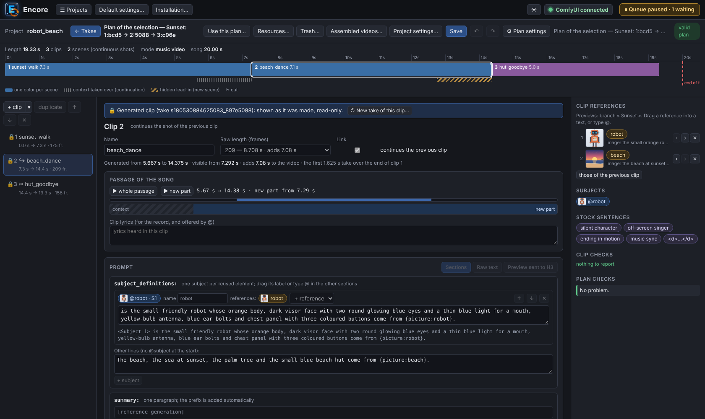
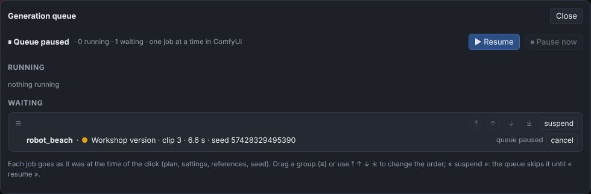

<p align="center">
  
</p>

<h1 align="center">Encore</h1>

<p align="center">
  <b>A local studio for MiniMax H3 music videos and shorts, driven through ComfyUI.</b><br>
  Plans, branches, takes, a generation queue and assembly, in your browser.
</p>

<p align="center">
  <a href="LICENSE"></a>
  
  
  <a href="README.fr.md"></a>
</p>

> **Disclaimer: this project is entirely vibe-coded.** All of its code, documentation and tests were
> written by an AI assistant (Claude, by Anthropic), following the author's requests. The author
> specified the features and tested the result in use, but neither wrote nor reviewed any of the
> code. Read it, test it on your own setup and use it at your own risk; issues and corrections are
> welcome.


## What Encore does

[MiniMax H3](https://huggingface.co/Comfy-Org/MiniMax-H3) makes clips of about ten seconds, with
picture and sound, from reference images. A music video or a short is a series of such clips that
follow one another. The ComfyUI plugin [ComfyUI-H3-ClipPlan](https://github.com/timpatim/ComfyUI-H3-ClipPlan)
describes that series in a **plan** (a JSON file: one prompt per clip, which clip continues which,
the references, the song). Encore is the application around it:

- **Plan editor**: clips on a timeline over the song, prompts edited by section, references and
  subjects as chips, checks of the plan and of each clip.
- **Takes as a tree**: every generation is a take; a continuation is built on the exact take it
  follows. Try several takes, keep the best chain (a *twig*), go back to an earlier one. Each twig has
  its own plan: the clips already generated are frozen, the next ones can be rewritten.
- **Branches**: the same plan with other pictures, another size, other LoRA or upscale settings,
  side by side, without mixing their takes.
- **Generation queue**: runs one job at a time in ComfyUI, survives a restart of ComfyUI or of
  Encore, can be reordered, paused and resumed; **▶▶ complete** fills a whole branch.
- **Latent upscale** (optional): generate small, then upscale in a second pass.
- **Assembly**: one click puts the chosen takes end to end on the song into a video.
- **Plan windows** that say exactly how a take was made, an installation
  screen that installs the node packs and downloads the models, English and French, dark and
  light themes.

ComfyUI is only the engine: Encore talks to it at its address and never changes its workflows.

## Screenshots

**Plan of the selection: generated clips 🔒 as they were made, clips over the song, prompts by section**



**Launch panel: a new take of clip 2, over the takes; which twig's plan to start from, the clip, the seed**


**Plan window ≡ of a take: the plan it was made with and everything used to generate it**


**Generation queue: reorder, suspend, pause, resume**



*(Screenshots made with the robot example of the plugin; the takes there are stand-in animations,
not real H3 renders.)*

## Requirements

- **Windows** or **Linux** (Mac not supported for now), **Python 3.10** or newer.
- A working **[ComfyUI](https://github.com/comfyanonymous/ComfyUI)** with MiniMax H3 support, on
  this PC or reachable on the network, and **git** (for the node packs).
- The node packs below; Encore's installation screen can install them for you:
  [ComfyUI-H3-ClipPlan](https://github.com/timpatim/ComfyUI-H3-ClipPlan) **3.11 or newer**,
  ComfyUI-H3-Motion-Context-MultiRef, ComfyUI-VideoHelperSuite; optional: ComfyUI-KJNodes
  (animated preview), the LBH latent upscaler nodes (upscale).
- The H3 models (diffusion model, text encoder, VAE, turbo LoRA): the installation screen downloads
  the default ones.

Encore itself only uses Python's standard library: nothing to `pip install`.

## Quick start

1. Get Encore: `git clone https://github.com/timpatim/Encore.git`, or **Code > Download ZIP** on
   GitHub and unzip it (anywhere, not inside ComfyUI).
2. Install and start it (details in [Installing Encore](#installing-encore)): on Windows,
   double-click `install.bat` then `Encore.bat`; on Linux, `./install.sh` then `./encore.sh`.
   Encore opens `http://127.0.0.1:8190` in your browser.
3. **Welcome screen**: give ComfyUI's address and folder, install the missing node packs, restart
   ComfyUI, download the default models.
4. **☰ Projects > New project**: a name, *free* mode (H3 makes picture and sound) or *music video*
   (a song is laid under the clips).
5. **master plan…** (branch header), then **Import a plan…**: a plan written by hand, by an LLM (the
   plugin gives the
   [system prompt](https://github.com/timpatim/ComfyUI-H3-ClipPlan/blob/main/docs/LLM_SYSTEM_PROMPT.md)
   for that) or one of the plugin's `examples/`. Or write it there.
6. **Resources…**: import the pictures (and the song or voices); the song is chosen in **Project
   settings**; the branch's **settings…** button gives a picture to each reference of the plan.
7. On the takes screen: click the box of clip 1 to generate a take, **+ next clip…** for the next
   clip, or **▶▶ complete** to queue the whole branch. Click a take to choose it.
8. Hover the last take: **▶ assemble 1–k** makes the video; it shows up in the **▶ Videos** pane.

The rest of this page is the full user guide.

# User guide

*Encore was called « H3 Studio » up to its version 0.16.* ComfyUI's address is
`http://127.0.0.1:8188` by default.

Messages, confirmations and inputs open in an Encore window in the middle of the screen
(Enter confirms, Esc cancels; for a deletion or a restore, « No » has the focus). Only the warning
when closing the tab with an unsaved plan is still the browser's own.

## Language

Encore is in English by default. Home page > **Default settings…** > **Language**: the page reloads
in the chosen language, including the server's messages, the `.infos.md` sheets and the queue labels
(what was already written, such as a branch name, stays as it is).

The texts are in `encore/locales/<code>.json` (`en.json`, `fr.json`): `{"id": "text"}`, with
`{name}` values filled in when shown. To add a language, copy `en.json` to `de.json` for example,
translate the texts and the `_name` key (the name shown in the list): it appears at the next start.
A text missing from a file is shown in English. H3 terms (`subject_definitions`, `fully_preserved`…)
and the content of the prompts are not translated.

## Light or dark theme

Dark by default. The **☀ / ☾** button of the top bar switches at once; the choice is also in
**Default settings… > Theme**, and it is kept in `config.json`. The video info pages follow it.
The light style sheet is derived from the dark one when the page is built (`encore/theme.py`).

## Installing Encore

Encore only uses Python's standard library: no package to download.

**With venv** (Python 3.10 or newer installed on the PC):

1. Get the `Encore` folder wherever you like (not inside ComfyUI): `git clone https://github.com/timpatim/Encore.git`,
   or download the ZIP from GitHub and unzip it.
2. Double-click `install.bat`: it creates the `.venv` environment in this folder.
3. Double-click `Encore.bat`: it starts Encore and opens `http://127.0.0.1:8190`.

**With conda**:

```text
conda env create -f environment.yml
conda activate encore
Encore.bat
```

**On Linux** (Python 3.10 or newer, with the venv module: `sudo apt install python3-venv`
on Debian/Ubuntu):

```bash
./install.sh     # creates .venv in the folder
./encore.sh      # starts Encore (or, with conda: conda activate encore, then ./encore.sh)
```

The Mac is not supported for now (you can try `python3 -m encore` from the folder, no guarantee).

Start options: `Encore.bat --port 8191` (or `./encore.sh --port 8191`), `--no-browser`.
The console window must stay open while you use it; Ctrl+C stops it.

**You had H3 Studio?** Unzip `Encore` next to the `H3Studio` folder (in the same parent folder):
at the first start, Encore takes over `config.json`, `defaults.json` and the queue (`queue.json`).
Projects do not move. (In ComfyUI, the working copy keeps its `h3studio_…` name.)

## First start: the « Welcome to Encore » screen

Encore goes no further until ComfyUI has everything it needs. The screen can be opened again
later with the **Installation…** button of the top bar (without blocking).

1. **ComfyUI**: its address, and its **installation folder** (the one that holds `custom_nodes`
   and `models`; for the portable version, the `ComfyUI_windows_portable` folder is enough).
   Encore finds **ComfyUI's Python**: `python_embeded` (portable version), `.venv` or `venv`
   (manual install, Desktop app). Otherwise, give the path of its `python.exe` (conda for
   example); « Check » runs it and makes sure torch is there. **git** is also needed (Git for
   Windows, git-scm.com).
2. **Custom nodes**: the packs Encore uses, with their state (loaded, installed but ComfyUI not
   restarted yet, missing, version too old). The required ones (ComfyUI-H3-ClipPlan,
   ComfyUI-H3-Motion-Context-MultiRef, ComfyUI-VideoHelperSuite) are checked from the start; the
   optional ones (ComfyUI-KJNodes for the animated preview, LBH nodes for the upscale) are checked
   as you like; a pack already in ComfyUI is checked and cannot be unchecked. Each name links to
   the pack's repository: **you can also install the packs yourself** (ComfyUI-Manager, git
   clone…), Encore detects them when ComfyUI restarts. **Install** does a `git clone` into
   `custom_nodes`, then installs the dependencies (`requirements.txt`) with ComfyUI's Python (`-s`
   for the portable version), without ComfyUI-Manager. The log shows below. A pack already present
   is recognized by its folder name or by the address of its git repository.
3. **Restart ComfyUI**: Encore does not restart it itself. It detects it going down and coming
   back, reads the node list again, and the **Continue** button turns on when all the required
   packs are loaded.
4. **Default models** (optional here): see below.

The pack list is in `encore/data/node_packs.json` (name, git repository, folder, expected nodes,
required or not): more can be added without touching the code.

## Default models: download

In the installation screen, and in the settings (**⬇ download the default model** button under
a model list when the default file is not in ComfyUI):

- ref2va pruned int8 diffusion model, Qwen3-VL 32B int8 text encoder, video and audio VAE, 8-step
  turbo LoRA (Hugging Face repository `Comfy-Org/MiniMax-H3`), and the LBH 3D upscale model
  (`LBH-123-AI/Minimax_h3_latent_Upscaler`);
- each file goes into its subfolder of `ComfyUI/models`;
- **before starting**, Encore reads the real size of the file on Hugging Face and compares it with
  the free space of the disk, with a 2 GB margin and counting the downloads in progress; when space
  is short, it refuses and gives the figures;
- progress, speed, cancel; an interrupted download resumes where it stopped (`.part` file);
- a protected repository needs a Hugging Face token (`hf_token` in `config.json`).

The list is in `encore/data/models.json`.

## Connection to ComfyUI

A permanent pill in the top bar: green « ComfyUI connected », orange « reconnecting… », red
« ComfyUI unreachable ». A click: address, version, since when, « Try again ». Generations started
during an outage wait in the queue. When ComfyUI comes back (after a restart), Encore reads the
node and model lists again.

## A project

```text
<projects folder>\<name>\
  project.json      settings: what the video is (mode, video, song, context), models, branches
  plans.json        the master plan of each branch and the plan of what follows each take
  refs\images\      imported pictures
  refs\voices\      imported voices
  refs\songs\       imported songs
  refs\videos\      imported videos (start or edited video)
  takes\clip_NNN\   takes: latent (.pt), signature (.json), preview (.mp4)
  selection.json    the selected twig (chosen take of clips 1 to k, each continuing the one before)
  jobs.json         waiting generations (only there while there are some)
  exports\          assembled videos (.mp4) and their sheet (.json)
  trash\            what was deleted, until restored or erased (Trash…)
  store\            (reserved)
```

- **☰ Projects**: list, creation (name = folder name; free mode or music video).
- **Import a plan…** (on the master plan screen of a branch): the file replaces the master plan of a
  branch that has no take yet; greyed once the branch has takes (make a new branch « from a plan file »).
  The seeds of the file are ignored. While the project has no take, the plan's mode, video and context
  become the project's.
- **Resources…**: imports pictures, voices, songs and videos (copied into `refs\`). A big file shows a
  progress window (cancel leaves nothing behind); it is written as it arrives. When ComfyUI's folder is known
  (welcome screen), files are later copied straight into its `input` folder, with no size limit;
  otherwise they go through ComfyUI's upload route, which refuses files over 100 MB unless ComfyUI is
  started with `--max-upload-size` (the queue shows « sending … to ComfyUI »). A video the browser
  cannot play (AVI, ProRes, HEVC…) gets a light H.264 copy for the players only, made by ffmpeg (the
  one of ComfyUI's Python, or on the PATH) with its progress; ComfyUI always gets the original. 🗑 deletes a file: refused while
  a branch or the start video uses it (the message says where), after a warning listing the
  takes that still need it, at once otherwise; its copy in ComfyUI goes too when
  ComfyUI's folder is known. An identical file is
  not copied twice. Accepted pictures: PNG, JPEG, WebP,
  BMP; the content is checked, and JPEG files named `.jfif`, `.jfi`, `.jpe`, `.pjpeg` or `.pjp`
  are saved as `.jpg` (same bytes).
- **Project settings…**: first **the project**: mode (music video or free), video (none, continue a
  video, edit a video) and its file, song (music video), context. They are the same for every branch and
  are fixed by the first take of the project (greyed, with the reason). Then preview quality, models and
  sampling, live preview. Buttons « Save as default settings » and « Apply the default settings ».

## Takes screen and plan screen

The **takes screen** is the main screen: branches, takes, queue, assembled videos. The plan is edited
on the **plan screen**, opened from it, which replaces it until **← Takes** (the plan is saved on the
way back if it was changed):

- **master plan…** (branch header): the plan of the branch before any take, the starting point of
  its new twigs. Every clip can be changed.
- **Plan of the selection…** (selection bar, above the graph): the plan of the selected twig. The
  clips already generated in it show 🔒 and are read only (their prompt is the one the take was made
  with); clips can be added, changed or removed after them. The changes stay in this twig: the
  master plan and the other twigs do not change. **Use this plan…** makes this plan the master plan of
  the branch (the previous one goes to the trash) or of a new branch with the settings of this one
  (nothing taken over): to try prompts that work elsewhere.

**Plans of a branch.** A branch has a master plan. Each take has the plan of what comes after it (its
*suite*): a new take of clip k records the clips k+1 to the end it was launched with. The plan of a
twig is the frozen part of each of its takes, then the suite of its last take. Nothing is copied: a
fork references the takes it continues. Once a branch has a take, the plan settings that would make
its takes inconsistent (mode, start or edited video, context) are frozen; assembly options (start
video in the final video, sound and common instruction of an edit) are not.

Three columns: the clip list, the clip editor, and on the right what the clip can use (references
with their thumbnails, subjects, lines or lyrics, stock sentences) and the checks. The plan
settings (mode, context, crossfade, song, declared references) are in **⚙ Plan settings**.

- **@ and drag and drop**: in the sections, `<Subject N>` shows as `@name`. Typing `@` opens a
  filtered list (subjects, `{picture:…}`, lines or lyrics, stock sentences): arrows, Enter or Tab,
  Esc. The labels of the right column can be dragged into any text. H3 always receives
  `<Subject N>`: the numbers are recomputed when the prompt is written.
- **subject_definitions**: one block per subject (working name, references, definition); ↑ ↓
  renumber everywhere; renaming does not change the prompt (the name is kept in `_subjects`,
  ignored by the nodes).
- **retention_analysis**: one line per subject (mode in a list), added or removed with it. A
  section of another shape is edited as text.
- **summary**: the `[reference generation]` prefix is added automatically.
- **detailed_description**: style, then one block per `[Shot N]`. The required opening sentence
  (continuation, or lead-in of a new scene) follows how the clip is linked to the previous one, and
  changes with it. An opening sentence written by hand (plans made by an LLM) is kept.
- **« ↺ from the previous clip »** on the style, the overall_soundscape and the non_diegetic_music.
- **+ clip** takes over the references, subjects, retention_analysis, style and overall_soundscape
  of the selected clip; ▾ offers an empty clip.
- **Passage of the song** (music video): « ▶ whole passage » (overlap included) and « ▶ new part »,
  played from the branch's song; bars of the passage in the song and of the overlap. The clip
  lyrics are below.
- Thumbnails, voices (▶) and song come from the branch of the plan shown.
- Showing a clip never changes its prompt: it is only written again for the section you edit.

Everywhere in the application, a drop-down list of at least 8 items (LoRA, models…) opens with a
filter field (several words allowed), arrows and Enter.

## Default settings

Home page > **Default settings…**: the language, the settings template (models, LoRA, sampling,
previews), and the picture size and reference size of the first branch. Each new project gets a
copy when it is created; they serve nothing else and do not change existing projects. Saved in
`defaults.json`, next to `config.json`. **LoRA**: a list (« + add a LoRA »); each LoRA has its
strength and a box to turn it off without removing it; they are applied one after the other. The
LoRA and models used are recorded in each take (visible in the larger preview); changing them
deletes no take. The model lists come from ComfyUI when it answers; otherwise names are typed by
hand.

- **Save** (Ctrl+S, plan screen): saves the plan shown (master plan or plan of the selection).
- **↶ ↷** (Ctrl+Z / Ctrl+Y): undo and redo the changes of the plan, on the plan screen and in the launch
  panel only (on the takes screen, they do nothing).

## Branches

A project says what the video is (mode, video, song, context: **Project settings**). **Branches** try
variations of it: picture size, segment of the video, references (picture and voice of each name of the
plan), LoRA, upscale, prompts. They are set in the **settings…** window of the branch (one button in its
header). The size: presets by format (16:9, 9:16, 4:3, 3:4, 3:2, 2:3) and
megapixels (0.2 to 2; 0.5 MP by default, that is 960 × 544 in 16:9; same sizes as ComfyUI,
1 MP = 1024 × 1024 pixels), or a free size in multiples of 32. A 0.2 MP branch lets you test a
prompt quickly before a 1 MP branch (the same seed does not give the same video at another size).
The same screen sets the **reference size** (`max` by default, or `match`), passed to the H3
reference encoder: it is no longer a field of the plan (`ref_image_size` is removed from the plan
on import or save). A branch keeps its set of references to the end; several branches let you try other
pictures, voices or sizes side by side. **Once a branch has a take, its size, the segment of its video
and the files of the references its takes use are frozen**: greyed in the windows, with a tooltip saying
why (a reference not used yet can still get a file). To try other values, duplicate the branch. LoRA,
upscale and reference size can always change.

- A new project has « Branch 1 », with an empty master plan. **+ new branch** opens a window:
  - **Empty**: references, settings and master plan of the last branch made;
  - **From a plan file…**: its master plan is the file;
  - **Duplicate a branch**: its settings and master plan, **without clips** (everything can change
    until its first take), or **with the clips 1 to k of the selection**: they are taken over by
    reference (no file is copied), shown dimmed in the new band (« ⇡ Branch 1 »), and generation goes
    on from clip k+1. Its master plan is the plan of that selection. The window lists the references
    with the first clip that uses them: those of the clips taken over stay fixed (« Marie from clip 6:
    take over clips 1 to 5 at most to keep her free »). A branch whose takes are taken over by another
    one cannot be deleted before it.
  Making a branch starts no generation.
- Each branch is a horizontal band (tree or columns), with on the left its color, its name
  (double-click or « rename »), its pictures, its voices, its song (hover a thumbnail: the large
  picture).
- **delete** (branch header, not while the branch is generating): moves its takes, its plans and its
  assembled videos to the trash, after a warning that counts them. The takes another branch takes over
  stay (shown in that branch). A branch number is never used again.
- **🗑** (on hover of a take): deletes it with every take made after it, in any branch; the confirmation
  lists them by clip and says what a branch that took it over keeps. Refused while a generation queued or
  running needs one of them.
- **Trash…** (project bar): what was deleted waits there. **Restore** puts an item back whole (a take
  with what followed it, a branch with its takes, master plan and videos, the clips other branches took
  over); **Erase** or **Empty the trash** deletes the files for good.
- **generate**: clip 1 of a branch, from its master plan.
- **+ next clip…** (on a take that has no continuation yet, even a take still queued, and in the
  dotted box to its right, always there, even after the end of the plan): opens the launch panel for
  the next clip after this take, pre-filled with the next clip of the selection's plan, else of the
  master plan, else a copy of the clip before (prompt, length, references, lines), continuing it (↪).
- **↻ new take…** (orange arrow on a take, also on a generation still queued or running): opens the
  launch panel for a new take of the same clip, after the same take of the previous clip (on clip 1:
  from the master plan). It makes a fork: a new twig, with its own plan.
- **▶▶ (branch header)**: fills the selected twig (or, when the selection is in another branch, the
  latest twig of this one) to the end of its plan, in order. Its tooltip says what it will do
  (« generate the clips 5 to 16 », « branch complete »); a summary (clips, estimated time) asks for
  confirmation, with the box « assemble at the end » (checked by default). Random seeds, branch
  settings. Refused while generations of the branch are already queued.
- **▶ assemble 1–k** also exists on hover of a take still queued: the assembly is planned and
  starts as soon as this generation (and those it depends on) are finished.
- **The selection** (click on a take) is a twig: the take clicked and the takes it continues, back
  to clip 1. Takes after it that still continue it stay selected. The selection bar above the graph
  names it and opens its plan. Choosing a take of another branch moves the selection there. A
  generation still queued or running can be chosen too: the selection goes through the take it will
  make.
- **New scenes (✂) follow the selection.** A take that starts a new scene does not depend on the
  pictures before it: it hangs on the take selected for the clip before when it starts there at the same
  moment of the song (same length before it; in free mode, always), and its continuation goes with it.
  Example: 3a ✂ made after 2a (5 s); choose 2b (5 s too): 3a moves under 2b, and 1 → 2b → 3a is a twig,
  with nothing to generate again.

### Launch panel

**↻ new take…** and **+ next clip…** open the same panel, over the takes screen:

- **Start from the plan of**: when several twigs go through this take (for instance 4a and 4b after
  3a), choose whose plan the new take starts from; hovering a twig highlights it in the graph;
  « whole plan ▸ » shows it.
- **Seed**: a new take of a clip starts with the seed of the take it redoes (🎲 for a random one;
  same seed and same prompt: Encore warns that the take will be identical); the next clip gets a
  random seed.
- **LoRA and upscale** of this take (pre-filled with those of the take redone, or of the branch for
  the next clip).
- **The clip**, in the plan editor: change its prompt before launching. Only this clip and the
  ones after it can change; the change is kept in the plan of the new take.
- **Generate** adds it to the queue.

Typing another seed in the seed field of a take + Enter launches a new take of this clip at once,
with this seed and the same settings.

### Folding a branch

The ▾ arrow at the top left of a branch header folds it: the branch becomes a thin band (color,
name, number of takes, generations waiting, ▶▶ still available). ▸ or a double click unfolds it.
The folded branches are remembered per project in this browser; the overview map follows. Centering
the view on a take of a folded branch (« ⌖ takes ») unfolds it.
At least one branch always stays unfolded (the arrow of the last one is greyed out). A folded branch
never holds the selection: folding the branch of the selection moves it to an unfolded branch (the one
of the latest valid take of clip 1). The folded bands all have the same width, ▶▶ lined up on the
right.

## Starting from an existing video

A plan can start from a segment of a video you already have: clip 1 continues it (same shot: its
last 1.6 s are taken over, picture and, in free mode, sound) or cuts after it.

1. In **Project settings**: video « Continue a video », and its file (the project's imported videos, or
   **Import…**). One video for the project: every branch uses it.
2. In **⚙ Plan settings > Video** of a branch's master plan, choose the segment in the player:
   « Segment from … to … », or « ⇤ here » / « here ⇥ » at the player's position; « ▶ play the segment » plays it. The segment is snapped onto the frame grid:
   its end is kept, its start moves forward by less than 0.7 s (the line below says what is used).
3. « clip 1 continues the video » or « cut after the video », and whether **the segment opens the
   final video** (otherwise it is only a springboard: the video starts with clip 1).
4. Music video, segment in the final video: **the song starts with the video** (default; the video
   loses its own sound and clip 1 comes later in the song) or **the video keeps its own sound and
   the song starts with clip 1**.

The segment shows on the plan screen's timeline before clip 1 (hatched when it is not in the final
video). When it opens the final video, the takes screen has a **Start video** column before clip 1:
the segment of each branch, linked to the takes of clip 1 that continue it (hover: plays it; click:
its settings, on the plan screen). It is not a take: it is neither generated nor chosen. The video is
read at 24 fps, resized to cover the branch's picture size and cropped in the middle. The file can only
be changed while the project has no take; the segment of a branch while it has none. Whether the segment is in the
final video changes nothing in free mode (in a music video it moves the song under the clips).

## Editing an existing video

A free-mode plan can edit a segment of a video you have: change its style, replace a character by a
reference picture, and so on. The timeline of the plan is the segment; each clip edits its own slice
of it, given to H3 as `<Video 1>` with its sound (the voices of the clip come after it, Encore numbers
them). In **Project settings**, choose video « Edit a video » and its file; then in **⚙ Plan settings >
Video** of a branch's master plan:

1. Choose the segment, as for a start video.
   The branches should have the proportions of the video, otherwise its picture is cropped: Encore
   says so and **gives them the video's proportions** on request (about the same number of pixels).
2. The sound of the final video: **the original sound of the segment** (default) or **the sound H3
   made** (to change a voice or a line).
3. **✂ Cut on the shots**: Encore finds the changes of shot of the segment (ffmpeg) and makes the
   clips: a new scene at each change of shot, a shot longer than a clip cut in equal parts that
   continue each other (« clips of at most 10.1 s » by default). The cuts are on the grid where clips
   can end; move them afterwards like any clip. It asks before replacing the clips of the plan.
4. Each clip gets a prompt that keeps the framing, motion and timing of `<Video 1>`, with `{edit}`
   where the edit goes. Write the edit once in **✎ Common instruction**, the first entry of the clip
   list (also reached from the settings): drag a reference from the right or type `@` to name a picture
   (« the man is replaced by {picture:homme} »); it is added to every clip that uses `{edit}`. A clip
   can complete it (`{edit}; the man also wears a red scarf`) or replace it (erase `{edit}`). The
   entry says which clips use it and shows how H3 gets it.

**Going on after the segment.** The clips that end before the end of the segment edit the video (🎞 in
the list and on the timeline, which shows the end of the segment); the next ones continue it like any
clip: add them with « + clip » after the last one (no `<Video 1>` in their prompt). « Cut on the shots »
replaces the edited clips only and keeps the ones after. With the original sound, the final video keeps
it over the edited part only.

A clip that edits a video lasts 2 to 15 s. On the takes screen, the empty card of a clip shows, behind
the « + », the part of the video it edits (hover: plays it). The file is frozen by the first take of the
project, the segment of a branch by its first take. A start video and an edited video cannot be combined in one plan.

## Generation queue (indicator on the right of the top bar)

Encore keeps its own queue, shared by all projects, and sends ComfyUI one job at a time. Each
generation or assembly is frozen at the time of the click (plan, settings, references, seed,
upscale) and sent when its turn comes. The queue survives an Encore restart.

- Groups: a job and those that continue it (« + next clip… » or ↻ started on a waiting job).
  Their order is fixed; the whole group moves (drag ≡, or ⤒ ↑ ↓ ⤓).
- **Batches**: everything a branch ▶▶ starts (generations and final assembly) makes one block,
  « ▶▶ Branch 1: clips 3 to 16 + assembly ». It is moved, suspended or cancelled as a whole; above
  5 jobs, the list folds. A generation started after a job of the batch joins it; another
  generation goes after the batch (it can be moved up).
- **Planned assembly**: it waits until every generation it needs is finished, and takes their
  takes at that moment. If a generation fails,
  only the jobs that depend on it stop (its continuations, and the assembly: « clip 6 it depends
  on has failed »); clips of another scene go on. Starting ▶▶ again only redoes the gaps, assembly
  included.
- **Pause after the running job**: it finishes, nothing else starts.
- **Pause now**: the running job is interrupted and goes back to the top of the queue; it will
  start again from the beginning, with the same seed.
- **Suspend** a group: the queue skips it until « resume ».
- **Cancel**: a job, and those that depend on it (after confirmation). If a generation fails, those
  that depended on it are removed from the queue.
- The indicator, always visible on the right of the « Encore » bar, sums up the state at a glance:
  « Empty queue » (gray), « ▶ generating · project · clip · step 3/8 · ≈ … left · +n waiting »
  with a progress bar (green), « ⏸ Queue paused · n waiting » (orange), « ✖ failed » (red, until
  the manager is opened). A click opens it. The browser tab title shows the state too (« ▶ 3/8 ·
  … »), visible even from another tab.
- Each job shows the length of the clip to generate.
- ComfyUI can run work of its own: a job sent by Encore then waits behind it (« sent to ComfyUI,
  waits behind n job(s) of its own »), and the start estimates become a minimum (« start in … or
  more »). Cancel and « Pause now » only touch Encore's jobs: the interruption names Encore's job
  (recent ComfyUI versions interrupt nothing else).

## Latent upscale (optional, per branch)

**settings…** window of the branch, « modify… » next to the upscale (⇧ on the button when it is on): first pass at a reduced size (in
megapixels, same proportions as the branch), latent upscale, second pass at the branch size. Off by
default.

- Pass 1: the first N steps of the settings schedule (scheduler, number of steps, SigmaShift), or a
  manual list of noise levels.
- Upscaler: LBH-123-AI 3D or 2D nodes (`Comfyui_Minimax_h3_latent_Upscaler` pack), or ComfyUI's node
  (MiniMax H3 Latent Upscale With Model); model in `models/latent_upscale_models`.
- Pass 2: manual list (default `0.9035, 0.8000, 0.6316, 0.3158, 0`, in 4 steps) or rest of the
  schedule; sampler and LoRA of pass 2 can be set apart (by default those of the settings).
- The seam with the previous clip and the song are put back as they are before pass 2 (ComfyUI's
  Separate/Concat AV Latent, Latent Cut, Replace Video Latent Frames nodes; plugin unchanged).
- Changing these settings changes no take; takes made with it carry the ⇧ mark (details on
  hover). A single take can use other settings, or none (see below).
- Time left is estimated separately for generations with upscale.

## LoRA and upscale per branch and per take

The LoRA stack of the Project settings always applies. « Extra » LoRA can be added:

- **Branch**: in its **settings…** window (⇧ and L on the button when they are on). Added to every take
  of the branch; « modify… » opens the upscale settings of its takes.
- **Take**: in the launch panel (↻ new take…, + next clip…): the LoRA list and the upscale for this
  take only. The upscale line is folded and says « like branch « X » » or « changed for this take »;
  **modify…** unfolds the full form (on/off, model, start size, passes…), started from the branch's
  settings; **reset to the branch's settings** goes back to them. From ↻, the panel is pre-filled
  with that take's LoRA and upscale; for the next clip, with those of the branch.

A continuation does not inherit the LoRA of the previous clip. These LoRA
also apply to pass 2 of the upscale. Each thumbnail carries its badges (L, L×2: extra LoRA, ⇧:
upscale; details on hover), like the queue and the video info. The plugin is not modified: Encore
adds the LoRA loaders to the workflow it sends.

The plan window **≡** (on a take, a generation in progress, a placeholder or a column header) ends
with a **Generation** block: models, LoRA, upscale settings (and where they come from), seed, size,
reference image size and song — those used for a take, or those that would be used if launched now.

## Assembly

On hover, each take shows a **▶ assemble 1–k** button: it adds to the queue the assembly of clips 1
to k along this twig (the take and those it continues). The selection does not change. Encore sends these takes to ComfyUI and runs the plugin's assembly node
(same result as in ComfyUI): the branch's song for a music video, the sound generated by the clips
in free mode, the branch size.

- The video is copied into `exports\`: `project_branch_YYYY-MM-DD_HHhMM.mp4`, with a sheet (branch,
  takes, clips covered).
- It appears in the « ▶ Videos » panel on the right of the takes screen, under its branch name (hover:
  play and source takes highlighted; click: large; « ⌖ takes »: center the view).
- **Assembled videos…** (top bar) lists them all, with a player.
- Next to the video, `<name>.infos.md` (readable summary: table of the clips with start/end in the
  video, take, seed, size, model, LoRA, sampler, steps, upscale; then the details and prompt of
  each clip) and `<name>.infos.json` (all the details, plus a copy of the plan at the time of the
  assembly). « infos » button in the player and in « Assembled videos… »: a page in Encore's
  colors (summary, clip table with their length, one card per clip with its branch dot, prompts),
  with links to the .md and the .json. Videos assembled before v0.11 have none.
- Each assembly has its own working copy in ComfyUI (purged at the end): several can be queued,
  even during generations; ComfyUI handles them in order. A copy of the video also stays in
  `ComfyUI\output\h3_clip_plan\h3studio_…\`.

### Plan of a clip, plan of a take

- **≡** before the name of a clip (column header): the clip as it is in the plan of the selection,
  read only (length, link, place in the video, references with their pictures in the branch shown,
  lyrics or lines, the prompt by section).
- **≡** on a placeholder (on hover): the plan of the clip now, with the pictures of that branch — to
  read the prompt again before launching.
- **≡** on a generation still queued or running (on hover): the plan it was launched with.
- **≡** at the top left of a take (on hover): the frozen part of this take — the clip exactly as it
  was generated (length, link, references with their pictures, lyrics or lines, the prompt by
  section, the common instruction of an edit) — then the Generation block.

## Generating

Each take thumbnail shows the length of its clip (e.g. « 8.7 s »).

Navigation: the wheel scrolls up and down, Shift + wheel zooms (25 to 200 %) around the cursor;
dragging (on the background or a thumbnail) scrolls left / right, up to the edges of the graph; the
scroll bar scrolls up and down. « fit » fits the width of the graph to the window. The branch
column (left) and the row of clip names (top) always stay visible when scrolling; they follow the
zoom.

Overview (corner of the area, bottom right by default, ⚙ to change corner, ✕ to minimize): the
whole area (graph and empty part of the window) in miniature with a frame for the visible part;
clicking or dragging on it centers the view, the wheel zooms.

▶ Videos panel (on the right, when videos are assembled, foldable with ▸): the videos per branch,
the latest at the top; hover = play and source takes highlighted, click = player, « ⌖ takes »
centers the view on the last take of the video.

« generate » on clip 1, ↻ new take… for another version, + next clip… for the next clip from a
take, even a waiting one. Several generations can be started: progress bar on the running
one, ⏳ on the waiting ones, « cancel » button on each. A click chooses a take: the choice is saved
right away in the project (`selection.json`).

**A take never goes stale.** It keeps the plan it was made with: changing the master plan or the plan
of another twig changes nothing for it. The settings that would make it inconsistent are frozen
(see Branches). Takes are only deleted with their branch.

**Seeds**: each take shows its full seed, selectable. Another value + Enter (or ↵) starts a new take
of this clip with this seed (same starting take for a continuation, same branch).

**Time left**: running thumbnails show « ≈ … left », waiting ones « start ≈ … ». The estimates come
from the pace of the steps of the running generation and from the length of earlier generations
(kept in `timings.json`, next to `config.json`, in proportion to the size and the number of
frames): they get better over time.

What Encore does for each generation:

1. it composes the plan of the twig (frozen part of each previous take, then the clip and those after
   it) and records the plan of what follows the new take;
2. it sends ComfyUI the plan (`input\h3studio\<project>\<branch>\plan.json`), the reference files
   (same folder, named after their content; the song: `input\h3studio_<project>_…`) and, for a
   continuation, the continued take with those it is built on;
3. it builds the workflow with the plugin's nodes and puts it in ComfyUI's queue;
4. it follows the generation and, once finished, copies the take (latent, signature, preview) into
   the project's `takes\` and chooses it.

On ComfyUI's side, the working copy is `output\h3_clip_plan\h3studio_<project>__<branch>\` (one per
branch): the prefix avoids any mix with your plans used directly in ComfyUI. When no generation of
the project is waiting any more, Encore empties it (option on the home page).

**Live preview** (Project settings… > Live preview): the thumbnail of the running generation shows
the preview received at each step; double-click to enlarge it.

- **ComfyUI** (default): one picture per step, as set by ComfyUI's « Live preview method ».
- **KJNodes – Model Preview Override** (ComfyUI-KJNodes pack): Encore adds this node to the
  workflow. With a TAE decoder (`models/vae_approx`, for example `taeh3`), true colors;
  « animated frames » at -1 (default): a small video of the whole clip at each step, with the
  generated sound if « sound » is checked (audible on hover with « sound on hover »).

**Diagnostics** (off by default): with `"diagnostic_preview": true` in `config.json`, Encore writes
what ComfyUI sends during generations to `diagnostic_apercu.log` (next to `Encore.bat`) and keeps
the first 20 previews in `diagnostic_apercu\`.

If Encore is closed while ComfyUI generates, the takes are collected when it opens again, once the
project is open.

Encore only listens on `127.0.0.1`: it cannot be reached from the network. It also refuses what
another web page open in your browser could send it: a request from another site, or from a site
whose name points to your PC, gets « request refused ». To open Encore from another device of your
network, start it with `--host 0.0.0.0` (only on a network you trust: anyone on it can then use it).

If ComfyUI stops answering while jobs are running there (restart, crash), the jobs it lost go back
to Encore's queue and are sent again when it answers (twice at most); what Encore had sent it
(pictures, voices, takes) is sent again too. Changing ComfyUI's address does the same.

## Development

- [docs/ARCHITECTURE.md](docs/ARCHITECTURE.md) (in French): which file does what, where to make a change, which
  tests to run for each file.
- `encore/`: the server (Python standard library only). `encore/locales/`: one file per language.
- `ui/`: the sources of the page (JavaScript, `editor_shell.html`). After a change, rebuild the page with
  `python ui/build.py`, which writes `web/index.html` (the translations and the light theme are put in it).
- `tests/`: unit and end-to-end tests, with a fake ComfyUI that runs the plugin's real nodes; see
  [tests/README.md](tests/README.md).
- `tests/screenshots/make_screenshots.py`: makes the screenshots of this page (`docs/screenshots/`) with the fake
  ComfyUI and the robot example of the plugin.
- [CHANGELOG.md](CHANGELOG.md): what changed in each version.

## License

GPL-3.0 (see [LICENSE](LICENSE)), like the [ComfyUI-H3-ClipPlan](https://github.com/timpatim/ComfyUI-H3-ClipPlan) plugin.
